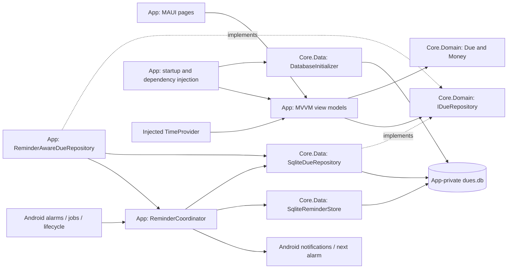

# Duewise - Software design

Authority: technical architecture and contracts supporting the [PRD](PRD.md). [DESIGN](DESIGN.md) owns visual/interaction standards; [STATUS](delivery/STATUS.md) owns delivery evidence; [TEST-PLAN](delivery/TEST-PLAN.md) owns execution procedures.

Source inspection: 2026-10-18, including F01 Details, F02 saved-data Dashboard, F03 Calendar, the F07 category slice and F05 reminders. The original implementation baseline was committed through `7c22b4b`; subsequent design adoption, navigation and production extensions are working-tree changes linked from STATUS. Descriptions are inspected code unless labeled proposed/deferred; source inspection is not runtime acceptance. The [previous SDD](delivery/SDD-2026-10-17.md) preserves original history; the [migration record](delivery/DOCS-REFACTOR.md) maps old sections.

## 1. Scope

Implement approved Android local CRUD using the existing Core domain/data and MAUI App boundaries. Preserve the [product rules](PRD.md#business-rules-and-validation); do not infer new features from schema placeholders or future design concepts. Repository/project names and Android package identity remain DueDateChecker; the app's display, icon, splash and shell identity adopt Duewise through the [design-adoption plan](../specs/design-adoption/plan.md).

## 2. Evidence boundaries

The original 2026-10-13 review described missing App wiring and an older UpdateAsync contract. Those observations are historical. Current App wiring, active-row update guards, and deletion handlers are described below. Test/build counts and phone acceptance are recorded only in delivery documentation.

[Project-file declarations](../src/DueDateChecker.App/DueDateChecker.App.csproj) establish Android-only targeting, ApplicationId `com.lem.duedatechecker`, display version 1.0, application version 1, minimum Android API 26, and XAML SourceGen. No global.json SDK pin is present. Historical installed SDK/workload versions remain in the plan/phase records; later design-adoption build/merged-manifest observations are recorded separately in [execution evidence](delivery/evidence/DESIGN-ADOPTION-2026-10-17.md#automated-and-build-evidence).

## 3. Source boundaries

- [Core project](../src/DueDateChecker.Core/DueDateChecker.Core.csproj): domain and persistence in one assembly.
- [App composition root](../src/DueDateChecker.App/MauiProgram.cs): platform path, clock, and service registration.
- [Initializer](../src/DueDateChecker.Core/Data/DatabaseInitializer.cs), [connection factory](../src/DueDateChecker.Core/Data/SqliteConnections.cs), and [repository](../src/DueDateChecker.Core/Data/SqliteDueRepository.cs): persisted behavior.
- [Editor](../src/DueDateChecker.App/ViewModels/DueEditViewModel.cs), [list](../src/DueDateChecker.App/ViewModels/DuesListViewModel.cs), and [dispatcher](../src/DueDateChecker.App/Services/DatabaseDispatcher.cs): application state and operation ordering.

## 4. Architecture

| Project | Responsibility | Current configuration |
|---|---|---|
| src/DueDateChecker.Core | Domain values, repository abstraction, raw SQL implementation, embedded migrations | net10.0; Microsoft.Data.Sqlite 10.0.12 |
| src/DueDateChecker.App | Android UI, view models, navigation, database path, clock and DI wiring | net10.0-android; CommunityToolkit.Mvvm 8.4.2; MAUI Controls version from MauiVersion; Microsoft.Extensions.Logging.Debug 10.0.0 |
| tests/DueDateChecker.Core.Tests | Domain and repository behavior using temporary database files | xUnit; Core reference |
| tests/DueDateChecker.App.Tests | Platform-independent view-model and dispatcher behavior, including real SQLite persistence and controlled failures | net10.0; linked App sources, xUnit, CommunityToolkit.Mvvm; no MAUI runtime |

Both test projects target net10.0 and declare xUnit 2.9.3, xunit.runner.visualstudio 3.1.4, and Microsoft.NET.Test.Sdk 17.14.1. Core.Tests also declares coverlet.collector 6.0.4. App.Tests declares CommunityToolkit.Mvvm 8.4.2 and links App sources. These are project-file declarations, not a fresh dependency restore. The exact MAUI Controls version is supplied by the installed workload through `$(MauiVersion)`, not pinned in this repository.

Domain files must not depend on MAUI or SQLite types. Core.Data implements the domain repository interface. App is the composition root and may reference both Core namespaces. This folder boundary is currently a convention inside one assembly.

Keep the existing repository abstraction; v1 does not need a generic repository, server API or sync service. The separately authorized F05 reminder coordinator and platform boundary are described below. View models use CommunityToolkit.Mvvm ObservableObject and generated commands/properties. Page code handles navigation and dialog presentation, while view models handle validation, domain construction, and repository calls.

SQLite calls currently expose Task methods but execute synchronously underneath. Awaiting them alone does not guarantee a responsive UI. DatabaseDispatcher runs database initialization and repository work on a background task and serializes operations using SemaphoreSlim. View models await those operations and apply bound state changes on the UI context. The dispatcher holds no long-lived connection and introduces no SQLite types into Domain.

## 5. Data design

### 5.1 Domain types and mutation rules

Money is a readonly record struct containing `long Centavos`. FromCentavos rejects negatives. FromDecimal rejects negatives, multiplies by 100, rounds with MidpointRounding.AwayFromZero, and converts to long. Overflow must become a user validation error, including overflow during multiplication. ToString uses a fixed peso symbol and invariant `N2` formatting; for example, 245000 centavos displays as `₱2,450.00`.

Due is an immutable record containing Id, Title, Amount, DueDate, Notes, IsPaid, CreatedAt, UpdatedAt, DeletedAt and validated DueCategory. Title validation also applies to a `with` edit. The App uses these mutation rules:

| Operation | State transition |
|---|---|
| Create | Due.Create generates a Guid, sets IsPaid=false and DeletedAt=null, and sets CreatedAt=UpdatedAt=now. |
| Edit or paid toggle | Copy the loaded active record with changed editable fields and UpdatedAt=now; preserve Id, CreatedAt, and DeletedAt. |
| Delete | SoftDeleteAsync sets DeletedAt=UpdatedAt=now, preserving other fields and the physical row. |

Obtain `now` from injected TimeProvider.GetUtcNow(). Store new App writes as UTC timestamps. The current mapper also accepts historical round-trip timestamps with nonzero offsets. Timestamp ordering is not a conflict-resolution algorithm; device clock changes can move UpdatedAt backwards. Future sync requires its own explicit policy.

DueDate remains DateOnly and must never be converted to UTC for persistence. The default date in a new form is today's date in Asia/Manila derived from the injected clock. For due creation the timezone provider belongs in App; Core Due receives the resulting DateOnly. The separately pure F05 planner receives an explicit TimeZoneInfo argument from App.

### 5.2 SQLite schema

Schema 1 is defined by immutable [001_create_dues.sql](../src/DueDateChecker.Core/Data/Migrations/001_create_dues.sql); [002_add_category.sql](../src/DueDateChecker.Core/Data/Migrations/002_add_category.sql) advances user_version to 2. [003_add_reminders.sql](../src/DueDateChecker.Core/Data/Migrations/003_add_reminders.sql) adds reminder settings/journal tables and advances current user_version to 3 without changing dues.

| Column | SQLite type | Meaning |
|---|---|---|
| id | TEXT PRIMARY KEY | Guid formatted as standard text; assigned before insert. |
| title | TEXT NOT NULL | Trimmed, required domain title. |
| amount_centavos | INTEGER NOT NULL | Nonnegative signed 64-bit centavo value. |
| currency | TEXT NOT NULL DEFAULT 'PHP' | Fixed v1 currency; reserved for future evolution. |
| due_date | TEXT NOT NULL | Invariant `yyyy-MM-dd`; lexicographic order matches calendar order. |
| notes | TEXT nullable | Optional user text. |
| is_paid | INTEGER NOT NULL DEFAULT 0 | App writes 0 or 1. |
| timezone | TEXT NOT NULL DEFAULT 'Asia/Manila' | Fixed product timezone; F05 uses the approved Manila zone rather than a per-row preference. |
| created_at | TEXT NOT NULL | DateTimeOffset round-trip `O` format. |
| updated_at | TEXT NOT NULL | Last mutation timestamp in the same format. |
| deleted_at | TEXT nullable | Null means active; a value is a tombstone. |
| category | INTEGER NOT NULL DEFAULT 0, CHECK IN (0,1,2,3) | Stable DueCategory code; legacy rows become Other. |

The category column is constrained; the original columns have no CHECK constraints for nonnegative amounts, paid flags, or fixed currency/timezone. These rules are enforced by App/domain paths, not the database. Due validates title but does not validate identifier or timestamp relationships. Any future database constraints require a new migration.

Currency and timezone are not properties on the current Due record and are not mapped by SqliteDueRepository. Inserts obtain their SQL defaults; updates leave them untouched. They prepare storage for future work but do not implement multi-currency support or sync.

The partial index `ix_dues_active_due_date` indexes due_date where deleted_at is null. The current list order is due_date, then created_at. Equal values for both keys have no guaranteed relative order. Paid status is not a list filter.

### 5.3 Repository contracts

| Method | Behavior |
|---|---|
| ListActiveAsync() | Return all rows with DeletedAt=null, including paid rows, sorted by due_date and created_at. |
| GetAsync(Guid id) | Return a row including tombstones, or null for an unknown id. |
| AddAsync(Due due) | Insert the supplied record. Duplicate ids fail through SQLite. |
| UpdateAsync(Due due) | Update editable fields and UpdatedAt on active rows; preserve stored CreatedAt/DeletedAt. Throw KeyNotFoundException for an unknown or soft-deleted id. |
| SoftDeleteAsync(Guid id, DateTimeOffset when) | Set both deletion/update timestamps only on an active row. Unknown/already deleted ids are a no-op. |

All user values use SQL parameters. Each operation opens and disposes a connection; no connection is shared between view models. Each mutation is one atomic SQL statement. There are no cancellation-token parameters in the current interface; UI lifecycle cancellation must not be presented as cancellation of an already-running write.

Before saving an existing due, load it again and reject null or DeletedAt!=null. The read/check/update share one dispatcher operation. UpdateAsync additionally enforces `WHERE id = @id AND deleted_at IS NULL` and never writes deleted_at, preventing a stale edit from restoring a tombstone even when deletion occurs after the read. Multi-writer edit conflicts remain outside v1; a future sync design needs an explicit concurrency policy.

### 5.4 Initialization and migrations

App owns `Path.Combine(FileSystem.AppDataDirectory, "dues.db")` and supplies exactly the same path to DatabaseInitializer and SqliteDueRepository. Core never discovers platform directories.

Initialize once per process before any repository access. DatabaseInitializer opens/creates the file, reads PRAGMA user_version, loads embedded numbered SQL scripts, and applies each newer script in numeric order. Each script and its version bump share one transaction. Re-running initialization at the current version 3 is a no-op.

Category migration 002 and reminder migration 003 are now present. Add future changes as `004_*.sql` and later; do not edit an already shipped migration. Migration failure blocks normal UI access and offers retry without deleting the database. The initializer now rejects negative/newer-than-supported user_version values without resetting the file; the newer-schema behavior is covered by a preservation test.

### F07 category contract

[DueCategory](../src/DueDateChecker.Core/Domain/DueCategory.cs) persists stable codes Other=0, Bill=1, Task=2, Subscription=3. Due validates enum values on construction/create/with; the optional constructor/factory argument defaults to Other for backward-compatible callers. App's new editor explicitly defaults to Bill. [Migration 002](../src/DueDateChecker.Core/Data/Migrations/002_add_category.sql) adds the NOT NULL constrained column with default 0, including tombstones, without rebuilding rows or changing old timestamps/values. Never edit 001 or 002; F05 later advances current schema to 3. Failed migration/version bump remains transactional and retryable without resetting data.

SqliteDueRepository includes category in SELECT/parameterized INSERT/UPDATE and maps its integer through domain validation. Null/unknown database values fail reads; no silent fallback. Active-row update and soft-delete preservation guards remain unchanged. Category does not affect sort/status/count queries; no category index or repository query API is needed.

DueEditViewModel exposes a fixed read-only category list, nullable draft selection, shared blur/Save validation, loaded saved value and captured category in guarded Save. Delete still ignores draft edits. Native Picker/field-error focus follows existing outlined controls and CanEdit. DueListItem/DashboardItem project literal category text/semantics for all saved-data pages. Dashboard category choice ANDs with title/status inside the existing stable observable collection; it does not replace ItemsSource or its persistent header. Clear resets all three constraints; summaries remain unfiltered. No extra service, preference store or navigation route is introduced. [PRD](PRD.md#f07-category-rules) owns user behavior.

## 6. UI and navigation

### F04 preference contract

[PRD preferences](PRD.md#f04-preference-rules) and [PF01-PF07](../specs/f04-preferences/spec.md#acceptance-scenarios) govern behavior. [AppPreferencesService](../src/DueDateChecker.App/Services/AppPreferencesService.cs) is a foreground UI-thread singleton with immutable current values, strict versioned encoding and a Changed event. [MauiAppPreferencesStorage](../src/DueDateChecker.App/Services/MauiAppPreferencesStorage.cs) adapts MAUI Preferences; one key `duewise.preferences.v1` stores `1|system|monday` or the supported alternatives. Missing means System/Monday. Read/decode errors retain last good/default state without rewriting storage. Save validates and writes the entire pair before publishing it; failed writes do not publish. This is one platform-preference write, not a SQLite transaction or guaranteed durability across a crash. No schema migration or financial/reminder data enters this store.

App initializes resources, loads the service and sets UserAppTheme before constructing Shell. System maps to AppTheme.Unspecified; explicit Light/Dark map directly. The application listens for successful preference changes; existing AppThemeBinding resources update immediately after Save. MainActivity already declares ConfigChanges.UiMode for runtime OS changes. Preference failure does not block window construction or dues initialization; Settings exposes retry and deliberate Save recovery.

[SettingsPage](../src/DueDateChecker.App/Pages/SettingsPage.xaml)/[SettingsViewModel](../src/DueDateChecker.App/ViewModels/SettingsViewModel.cs) are transient pushed routes with hidden tabs. Native pickers are drafts until Save; appearance/resume/return from Reminders reloads saved state without overwriting the existing draft. Dues Settings entry does not require CanAdd/database readiness. Reminders is pushed above Settings and returns through it; direct Dues-to-Reminders remains. ReminderTapRouter defers while Settings is current to protect its draft, then retries on subsequent navigation. No export, restore or empty settings destinations are registered.

CalendarViewModel receives the shared preferences service. Constructor and each load/appearance use the current saved week start. CalendarPage.RefreshAsync applies RefreshPreferences before sharing any unfinished data read, so appearance does not wait for storage to finish before adopting the layout. RefreshPreferences rebuilds headers/offset/caption while retaining Month/SelectedDate and the same saved snapshot/agenda collection. Sunday offset is DayOfWeek; Monday offset is (DayOfWeek+6)%7. Padding stays within the fixed 42 cells without constructing dates outside the month, preserving DateOnly bounds. Calendar does not subscribe to a global event while cached/hidden; next appearance applies the saved preference even if the subsequent dues read fails.

### F05 reminder contract

[PRD reminder rules](PRD.md#f05-reminder-rules) own user policy; [RM01-RM08](../specs/f05-reminders/spec.md#acceptance-scenarios) own scenarios. [ADR 007](adr/007-local-reminder-reconciliation.md) records the disposable-alarm/reconciliation choice. Core's [ReminderPlanner](../src/DueDateChecker.Core/Domain/ReminderPlan.cs) receives dues, validated settings and an explicit timezone. App supplies Asia/Manila and injected UTC clock; due_date remains DateOnly. Occurrence identity is invariant `dueIdN/dueDate/offset/scheduledUnixMilliseconds`; offsets stay distinct if quiet hours merge times. No title/amount/notes enter scheduler payloads.

[Migration 003](../src/DueDateChecker.Core/Data/Migrations/003_add_reminders.sql) adds singleton `reminder_settings` (enabled/day_before/minute_of_day/quiet_start/quiet_end; booleans and minute ranges constrained) and `reminder_occurrences` (key primary key, due ID/date, scheduled UTC instant, nullable delivered UTC instant). Settings default off. [SqliteReminderStore](../src/DueDateChecker.Core/Data/SqliteReminderStore.cs) uses parameters, invariant date/UTC stamps, and transactional replacement of pending rows while preserving delivered receipts. These tables do not change Due or existing rows. Receipt retention prevents normal replay; no pruning/backup/restore feature is added.

[ReminderCoordinator](../src/DueDateChecker.App/Services/ReminderCoordinator.cs) and its store/platform/clock are singletons. The coordinator uses the existing DatabaseDispatcher gate and the **raw** SqliteDueRepository to avoid recursive dispatch. Each reconciliation reads committed dues/settings/journal, captures its planning clock after those reads, checks app/channel permission, removes invalid displayed notifications, replaces pending occurrences, posts at most ten ready notifications, rechecks the clock before every post, records the delivery-time receipt, prunes work that expired during the pass, and replaces one alarm from a fresh scheduling clock. Newly elapsed instants are skipped; only existing queued keys can catch up before expiry. If ready work remains, schedule at least one minute later. Exceptions preserve committed settings/dues and request a five-minute retry where possible; Reminders exposes retry/error state. OS posting and receipt commit are not atomic: stable notification tag and OnlyAlertOnce reduce duplicate alerts, without an exactly-once claim.

The IDueRepository registration is [ReminderAwareDueRepository](../src/DueDateChecker.App/Services/ReminderAwareDueRepository.cs) around the singleton raw repository. Successful writes cancel that due's displayed notifications and enqueue a job. These post-commit side effects do not await reconciliation while the dispatcher gate is held; failures cannot turn committed Save/Delete into a reported write failure. All foreground/background decisions and due writes share this in-process gate. This is not cross-process synchronization or multi-writer conflict resolution.

[AndroidReminderPlatform](../src/DueDateChecker.App/Platforms/Android/AndroidReminderPlatform.cs) creates a stable channel, checks API-33 runtime notification permission plus app/channel blocking, and requests permission only from explicit Enable. It uses a replaceable immutable PendingIntent with AlarmManager.SetAndAllowWhileIdle (inexact), an API-31+ expedited immediate JobScheduler job with same-ID normal-job fallback when quota is rejected (API 26-30 use normal jobs), and a persisted 15-minute recovery job while pending work exists. Disable/blocked/empty queues cancel the alarm and recovery job. A private [receiver](../src/DueDateChecker.App/Platforms/Android/ReminderReceiver.cs) delegates alarm, boot-after-unlock, package replacement, clock and timezone events to JobScheduler; JobService owns async lifetime/retry. App window creation/resume also reconciles. Manifest adds POST_NOTIFICATIONS and RECEIVE_BOOT_COMPLETED; no exact-alarm permission, foreground service, network or server dependency is added. Force-stop/Doze/OEM restrictions can still defer or prevent delivery.

Generic private notifications use an app-owned monochrome icon and carry only due ID and occurrence key. Explicit immutable intents target MainActivity; there is no public VIEW/deep-link filter. [ReminderTapRouter](../src/DueDateChecker.App/Services/ReminderTapRouter.cs) validates input shape, then the coordinator checks a delivered receipt, current active/unpaid due/date and current planned key. Router selects Dues, then F01 Details. Cold-launch taps queue until Shell loads; taps received during DueEditPage stay queued until leaving, preserving draft input. Invalid targets are discarded; navigation failures retain the tap for retry. Taps never mutate dues. Test notifications contain static text and open the app without a due target.

[ReminderSettingsPage](../src/DueDateChecker.App/Pages/ReminderSettingsPage.xaml) is a pushed route from Dues with tabs hidden. Its view model keeps schedule edits as a draft across refresh, saves only on Save or Save and enable, and does not persist opt-in after denied permission. Disable uses the saved schedule with enabled=false while retaining draft controls. Busy/not-loaded guards prevent conflicting actions; status-read failures do not misreport a committed settings save. Page appearance and resume refresh notification and Android-reported battery/background status; no launch permission prompt is introduced. ActivityManager background restriction (API 28+), PowerManager Battery Saver and battery-optimization exemption are read independently. Explicit Android app/battery settings opens APPLICATION_DETAILS_SETTINGS for this package, without changing power policy or requesting an exemption. Vendor controls may not be reflected in Android-reported state, so neither state nor setting is a delivery guarantee. Device/build acceptance is tracked separately in STATUS.

### Design resource and layout mapping

The authorized [design adoption](../specs/design-adoption/spec.md) maps DESIGN theme pairs to `Resources/Styles/Colors.xaml` and component/type styles to `Styles.xaml`. MauiProgram registers four bundled Plus Jakarta Sans aliases; license/provenance are bundled under `Resources/Raw/Fonts`. ApplicationTitle changes to Duewise; ApplicationId and database path remain unchanged. App icon/splash use source SVG assets rather than an image-generation or icon-library runtime.

`Pages/PageLayout` applies DESIGN width breakpoints, margins and maximum readable width in logical units when page size changes. List header/actions scroll within CollectionView; cards and the editor stay single-column, and amounts wrap separately. Existing handlers retain ID-only edit navigation and mutation guards. The editor's Unfocused handlers call no-write field validation; Save revalidates, focuses the first invalid control and announces its error. Field border triggers show focus/error state; Android handler mappings remove redundant native underlines inside the outlines. Native day/night colors keep status-bar contrast consistent with the canvas. Paid/Unpaid badges keep literal status text. This original list/editor visual-adoption slice did not add status calculations, schema changes or a scheduler; separately authorized F02/F03/F07/F05 extensions are described below.

The [future-page roadmap](../specs/future-pages/plan.md) maps DESIGN screens to dependencies and acceptance. F01 Details, [F02 Dashboard](../specs/f02-dashboard/spec.md) and [F03 Calendar](../specs/f03-calendar/spec.md) are authorized production extensions. MP/BN mock records remain historical; other production pages remain deferred. Current verification results and limits belong in STATUS.

### Dashboard/calendar preview boundary

AppShell hosts native tabs (`main`): default Dues (`dues/list`), saved-data Dashboard (`dashboard/dashboard-home`) and Calendar (`calendar/calendar-home`). DashboardContent and CalendarContent resolve their transient pages lazily through DI; Shell retains each page and its ephemeral selection state. Tab selection does not push duplicate pages. Registered DueDetailPage and DueEditPage routes work inside every saved-data tab stack using IDs only; both hide the bar. Details' Back to list pops to its original parent; Add returns to its calling root. Root Back from Dashboard or Calendar selects Dues. Preview routes/pages/fixtures have been removed; MP/BN evidence describes earlier artifacts.

MauiProgram registers the Android [DuewiseShellRenderer](../src/DueDateChecker.App/Platforms/Android/DuewiseShellRenderer.cs). Its appearance tracker delegates theme/selection/inset behavior to Shell, then sets the bar's minimum height to `64 + 20 × (max(1, FontScale) − 1)` logical units (84 at 200%). This prevents the native default height from crowding scaled labels against icons. It does not replace tab navigation or implement its own gesture/inset logic.

Both data pages use a single vertical CollectionView with a persistent header; Calendar's month grid alone scrolls horizontally at compact widths. Numeric date counts and literal status labels do not depend on color. Shared PageLayout, fonts and semantic resources apply. Dashboard retains DueProgressView for paid/total progress.

### F03 Calendar data and lifecycle

[CalendarViewModel](../src/DueDateChecker.App/ViewModels/CalendarViewModel.cs) injects DatabaseDispatcher, IDueRepository and TimeProvider. It reads ListActiveAsync without new SQL APIs, defensively excludes tombstones, sorts by date/CreatedAt, groups exact dates for counts and projects the selected day's rows through the existing DashboardItem/DueStatusCalculator. CalendarDay exposes immutable date/count/selected/today semantics. No read or selection writes. [PRD](PRD.md#f03-calendar-rules) owns week-start, selection, Today and Add policy.

The view model caches its last successful snapshot, handles initialization/read retry with stale-data errors, and guards overlapping loads. The agenda exposes one read-only observable collection using granular events; empty messages stay inside the persistent header. The grid uses 42 cells with the [F04 saved week start](#f04-preference-contract), default Monday, skips padding and bounds month navigation without overflowing DateOnly. Date buttons have minimum 48-unit width/64-unit height, numeric counts and full-date/count/selection/today descriptions. No fixture source remains.

CalendarPage shares its load task across appearance/resume, starts a minute dispatcher date timer only while visible and stops it on disappearance. Read completion uses the current Manila date and the latest selection, even if either changed during a read. Date refresh changes today's marker/agenda statuses without moving month/selection. AppShell's visible-page refresh includes Calendar and leaves unfinished editor fields untouched. ID-only Details/editor routes and Add reuse the original root stack; successful writes reload committed data. No background schedule, preference store, migration or new service lifetime is introduced.

### F02 Dashboard data and lifecycle

Core's [DueStatusCalculator](../src/DueDateChecker.Core/Domain/DueStatus.cs) is pure: Due plus an explicit product DateOnly returns a derived status, or null for deleted dues. It has no clock/MAUI/SQLite dependency. [PRD policy](PRD.md#f02-dashboard-rules) owns precedence, boundaries and membership. No schema/paid-state mutation is introduced.

DashboardViewModel reads ListActiveAsync through DatabaseDispatcher, copies the last successful snapshot, classifies/sorts rows and applies the current trimmed ordinal-ignore-case title query AND single status filter. Global counts use that full active snapshot; results/empty/no-match use the filtered projection. Initial failure shows error/retry without empty success; refresh failure retains the last snapshot with a stale-data warning. Queries/status changes and date reclassification perform no storage writes.

Visible rows are exposed through one ReadOnlyObservableCollection for the page lifetime. Query/read updates reconcile inserts/removes/moves/replacements without swapping ItemsSource or emitting Reset. Native verification found that replacing the bound array rebuilt Android's header Entry and dropped search focus after the first character; stable incremental updates address that boundary. Snapshot ownership stays private and callers cannot mutate the visible collection.

Empty/no-match cards also live in that persistent header, with visibility bound to the VM flags; Dashboard does not assign CollectionView.EmptyView. Native cleanup exposed another header replacement when Android switched its empty adapter. Keeping the cards in the same header preserves typing across populated ↔ zero-result transitions. This is a UI hosting change, not a change to filtering/count rules.

DashboardPage shares its read task across appearance/resume. The visible page's dispatcher timer recalculates the injected clock's Asia/Manila date every minute; it stops on disappearance. Appearance, resume and read completion also use the current date; no background exact-midnight work is scheduled. AppShell.RefreshCurrentPageAsync refreshes only a visible Dues/Details/Dashboard page, preserving editor input. Returning through Details after writes or from Dashboard Add re-reads committed data with query/filter retained. See [DB01–DB07](../specs/f02-dashboard/spec.md#acceptance-scenarios).

The App contains Pages/DuesListPage, Pages/DueDetailPage and Pages/DueEditPage, with corresponding view models in ViewModels/. AppShell hosts the injected list root and registers detail/form routes. App receives IServiceProvider and resolves Shell in CreateWindow, after InitializeComponent has loaded application resources; eagerly injecting Shell would construct the list before its StaticResource styles exist. The window retains Shell for its lifetime. The template MainPage is removed. Add opens a fresh form; selecting a row opens Details, whose Edit action pushes the existing form with the same id.

V1.2 navigates using only a due id and loads its data through the repository. No id means create mode; a supplied invalid id is unavailable and cannot become an insert. DueEditPage uses IQueryAttributable and observes its load command on appearance. Once loaded, repeated query/appearance events do not overwrite unsaved input. The following table includes the V1.3 deletion implementation; [STATUS](delivery/STATUS.md) distinguishes observed verification from remaining release acceptance.

| Screen | Bound state | Commands and behavior |
|---|---|---|
| DuesListPage | Active dues collection, IsBusy, error message, empty state | Load/refresh and Add; selecting a row opens Details. Each row shows title, formatted amount/date, and paid/unpaid text. |
| DashboardPage | Last-successful active snapshot, derived statuses/global counts, filtered results, query/filter, loading/stale error/empty/no-match states | Read/refresh, title search, single-status AND filtering, clear, Add and ID-only Details navigation. Re-read on appearance/resume; visible minute timer recalculates date. |
| CalendarPage | Last successful snapshot, month/date, numeric counts, selected-date agenda, loading/stale error and empty states | Read/refresh, month/day selection, Manila Today, Add and ID-only Details; appearance/resume and visible minute date refresh. |
| DueDetailPage | Read-only DueListItem, notes, UTC timestamps, IsBusy, error/unavailable state | GetAsync for the selected id; Edit, Back and retry. Reject tombstones; no writes. Re-read on appearance/resume, clearing unverified fields while loading or after read failure. |
| DueEditPage | Title, AmountText, selected date, Notes, IsPaid, create/edit mode, validation errors, IsBusy | Load, Save, Cancel; edit mode also offers Delete with confirmation through the page handler. Paid state is editable and persists on Save. |

Use a CollectionView for the list. Paid state must have a text indication; color alone is insufficient. Give fields and actions accessible labels. Save and delete controls are disabled during an operation, and refresh is prevented from overlapping another load. New dues default to unpaid; the paid control is introduced for existing dues in V1.2.

Reload each saved-data root when it appears after Details/direct Add or resumes. DueDetailPage shares its refresh task across appearance/resume. Its ID-only IQueryAttributable target is applied once per page instance; missing/malformed/empty IDs and GetAsync null/tombstones are unavailable, never inserts. DueDetailViewModel clears Item before reads; failures disable Edit and offer retry for the same ID. Navigation failure retains a loaded item for another attempt. AppShell.RefreshCurrentPageAsync handles visible Dues, Details, Dashboard or Calendar; it leaves unfinished editor fields untouched. No cold-start navigation stack restoration is promised.

Editor return uses one pop: Save/Cancel/Back returns to reloaded Details when entered there, or the calling root (Dues/Dashboard/Calendar) for direct Add. Delete returns to unavailable Details; Back to list reloads the original root. Completed/unavailable editor return controls say Go back, and successful-write navigation errors retain completion state without repeating the mutation. Do not append optimistic rows then load them again. Successful repository writes precede navigation and visible success.

Save flow:

1. Validate title, amount parsing/range, and date selection; show field errors without touching the database.
2. Convert amount through Money.FromDecimal; show the resulting peso value.
3. Capture one clock instant. In create mode, construct Due.Create; in edit mode, re-read the active record and copy editable fields.
4. Await AddAsync or UpdateAsync through the serialized background dispatcher.
5. On success, pop to the parent (Details or calling saved-data root) and reload it. On failure, keep form contents and present a retryable error.

Delete flow:

1. DueEditPage shows a native confirmation naming the original stored title. A page action guard prevents overlapping dialogs/actions. Cancel supplies false to the command and performs no storage call. A false result from native Back/dismissal is guarded independently in the view model; observed native results and remaining acceptance gates are tracked in [STATUS](delivery/STATUS.md).
2. On explicit confirmation, DeleteCommand checks that the target is an existing, loaded, available, incomplete record. It passes the id and one clock instant to SoftDeleteAsync through the dispatcher; it does not validate or save unfinished form values.
3. After successful completion, mark HasDeleted and pop to the parent. Details reloads to unavailable; direct editor navigation from Dues returns to the refreshed list. On failure, retain the page/input and allow a newly confirmed retry. Save/Delete are disabled during writes. After a navigation failure, HasCompleted provides Go back without repeating a mutation.

If confirmation display throws, the page reports an error without calling storage. The destructive button uses semantic overdue/surface colors, outline, and minimum dimensions from [DESIGN](DESIGN.md). The approved v1 scope has no Undo/restore interaction; the broader product design's Undo remains deferred.

Back/Cancel discards unsaved fields without writing. A deleted or unknown navigation target displays “This due is no longer available” with a return-to-list action. v1 has no recycle bin or restore command.

## 7. Dependency lifetimes and startup

| Registration | Lifetime | Reason |
|---|---|---|
| DatabaseInitializer | Singleton | One file path and an awaited startup initialization. |
| SqliteDueRepository; IDueRepository → ReminderAwareDueRepository | Singleton | Raw repository holds the path; decorator queues post-commit reconciliation without dispatcher re-entry. |
| TimeProvider.System | Singleton | One injectable clock source; tests substitute a fixed clock. |
| Database operation dispatcher | Singleton | Serializes initialization/reads/writes off the UI thread. |
| IReminderStore, IReminderPlatform, ReminderCoordinator, ReminderTapRouter | Singleton | Shared file/platform state, serialized reconciliation and one pending tap per app process. |
| ReminderSettingsPage/ViewModel | Transient | Separate settings draft for each visit; saved preferences remain in SQLite. |
| AppPreferencesService / IAppPreferencesStorage | Singleton | UI-thread current preferences and one MAUI Preferences value; independent of the SQLite dispatcher. |
| SettingsPage/ViewModel | Transient | New draft per Settings visit; successful saves publish theme/week-start together. |
| AppShell | Transient registration; resolved after app resources load and retained by the single Window | Root navigation container. |
| CRUD pages and view models | Transient DI registrations | Separate form state per navigation. |
| CalendarPage/ViewModel | Transient DI registrations resolved lazily by CalendarContent, retained by Shell | One session's viewed month/date and last successful local snapshot; injected database/clock dependencies. |
| DashboardPage/ViewModel | Transient DI registrations resolved lazily by DashboardContent, retained by Shell | One session's query/filter and last successful local snapshot; database/clock dependencies are injected. Process restart resets ephemeral state. |

The bootstrap sequence is: build DI registrations, display the list's startup/loading state, initialize SQLite in the dispatcher, then enable Add. The load task is awaited; startup errors remain visible and retry must complete initialization before Add becomes available. There is one Android window. F05 background jobs write only reminder settings/journal state through the same singleton dispatcher; due edits remain foreground operations.

V1.1 implements this through an awaited list-load command: the list page initially displays loading state and disables Add until initialization completes. The page shares its load task across appearance/resume events. Lifecycle event handlers await the task; the view model catches initialization/read failures, displays a retry message, and keeps CRUD unavailable on startup failure.

## 8. Failure handling, privacy, and practical limits

The [PRD error/recovery requirements](PRD.md#error-and-recovery-requirements) own required outcomes. Implemented mechanisms are:

- DueEditViewModel validates fields before dispatch and catches conversion overflow; load/save/delete errors become bound messages and busy state is cleared in finally blocks.
- DatabaseDispatcher sets its initialized flag only after initialization succeeds, allowing a failed initialization to retry without deleting the file. DuesListViewModel blocks Add until initialization succeeds; a subsequent read failure retains ready state and any previous rows with an error.
- List results replace bound rows only after successful reads. An already-loaded editor does not overwrite unsaved input on repeated load requests.
- Missing/deleted targets are rejected on load/save; repository update guards also protect against deletion after the App read.
- SavedDueId/HasDeleted retain successful mutation state across return-navigation failure; repeated mutation commands are guarded.
- SQLite commits remain authoritative after process termination. Unsaved form recovery, database repair, and automatic downgrade/reset are not implemented.

SQLite is the source of truth. There is no export, account restore, or server backup in v1. App-private storage and `android:allowBackup="false"` are configured, but this is ordinary SQLite without application-level encryption. Uninstalling or clearing app data loses dues; soft deletion preserves a row only while the database remains present.

Do not log titles, amounts, notes, raw SQL parameters, or signing passwords. Keep keystores outside the repository and local.signing.props ignored. The existing Android manifest retains template INTERNET and ACCESS_NETWORK_STATE permissions; no v1 functionality should make network calls. Removing unused permissions can be considered during release cleanup.

## Requirement-to-component mapping

Requirement definitions and product acceptance outcomes remain in the [PRD](PRD.md#approved-requirements).

| IDs | Components / contracts | Verification boundary |
|---|---|---|
| R01 | App project, conditional local signing import, Android manifest, App/CreateWindow and Shell | Release/signing/launcher checks; historical build is not current signing evidence. |
| R02 | DueEditPage, DueEditViewModel, Due.Create, Money, AddAsync, dispatcher | Domain/Core/App tests plus native create/restart. |
| R03 | DuesListPage/ViewModel, DueListItem, ListActiveAsync and partial index | Repository/list tests plus native order/empty/refresh checks. |
| R04, R05 | ID-only navigation, editor load/save, immutable copy, guarded UpdateAsync | Edit/reopen/race tests plus native edit/paid/restart. |
| R06 | Page confirmation, DeleteCommand, SoftDeleteAsync, active filtering | [Soft-delete plan](../specs/v1.3-soft-delete/plan.md), delete tests, native confirmation/tombstone checks. |
| R07 | App-private SQLite and local operations; no account/server dependency | Offline phone procedures for all CRUD paths. |
| R08 | `.github/workflows/ci.yml` runs the Core and App test projects on a Linux runner on every push ([V1.4 plan](../specs/v1.4-ci/plan.md)) | Observed passing GitHub run, recorded in STATUS. |
| F01 extension | DueDetailPage/ViewModel, selected-ID GetAsync via dispatcher, Shell route and visible-page resume refresh | [DT01–DT06](../specs/f01-item-details/spec.md#acceptance-scenarios), SQLite state tests plus native detail/editor return checks. |
| F02 extension | DueStatusCalculator, DashboardPage/ViewModel, ListActiveAsync/dispatcher, injected clock and cached root navigation | [DB01–DB07](../specs/f02-dashboard/spec.md#acceptance-scenarios), Core/App tests and native lifecycle/filter/editor checks. |
| F03 extension | CalendarPage/ViewModel, ListActiveAsync/dispatcher, injected clock, F02 classifier and F01 parent stack | [CA01-CA07](../specs/f03-calendar/spec.md#acceptance-scenarios), Calendar tests and native selection/lifecycle/editor checks. |
| F07 categories | DueCategory validation, migration 002/schema 2, category-aware repository/editor/projections and Dashboard filtering | [CT01-CT06](../specs/f07-categories/spec.md#acceptance-scenarios), category Core/App tests and native migration/filter/editor checks. |
| F05 reminders | ReminderPlanner/IReminderStore/schema 3, serialized coordinator, repository decorator, Android platform/receiver/job, settings page and tap router | [RM01-RM08](../specs/f05-reminders/spec.md#acceptance-scenarios), Core/App reminder tests, Android build and separately attributed native permission/lifecycle/delivery/tap checks. |
| F04 preferences | AppPreferencesService/MAUI Preferences adapter, startup theme, draft Settings and saved calendar week start | [PF01-PF07](../specs/f04-preferences/spec.md#acceptance-scenarios), App service/calendar tests, Android build and separately attributed native persistence/theme/navigation checks. |

## Verification strategy

Use domain/Core tests for invariants and SQL behavior, the linked-source App harness for view-model/dispatcher behavior, and the Android Release build/device for XAML, handlers, navigation, lifecycle, and trimming. The [test plan](delivery/TEST-PLAN.md) owns commands, coverage inventory, gaps, and acceptance procedures. Recorded results belong in [STATUS](delivery/STATUS.md) and phase evidence, not this contract document.

## Deferred extension points

- F05 local date-only reminders are implemented under the [F05 contract](#f05-reminder-contract). Recurring/timed reminders, per-due presets and cloud push remain deferred; DateOnly/timezone placeholders do not implement them.
- Authentication/sync require explicit outbox, ownership, conflict-resolution, RLS, and token-storage contracts. Guid identities and tombstones alone do not provide synchronization. Multi-writer edits are outside v1.
- SQLCipher/encryption and backup/export have no approved implementation decision; review privacy/data-loss tradeoffs before extending storage.
- Distribution is sideloaded APK for v1. Play signing and current platform/store requirements need separate review when that scope begins.

The [ADR index](adr/README.md) explains absent legacy ADR references and how to record supported decisions without inventing rationale. Learner checkpoints are preserved in historical notes; implementation authorization is not demonstrated understanding.

## Implementation references

The following links are retained from the prior SDD for reference; their contents and current platform guidance were not revalidated during this documentation refactor.

- [MAUI dependency injection](https://learn.microsoft.com/en-us/dotnet/maui/fundamentals/dependency-injection?view=net-maui-10.0): constructor injection and transient pages/view models.
- [MAUI DatePicker](https://learn.microsoft.com/en-us/dotnet/maui/user-interface/controls/datepicker?view=net-maui-10.0): nullable date binding in .NET 10.
- [MVVM Toolkit commands](https://learn.microsoft.com/en-us/dotnet/communitytoolkit/mvvm/generators/relaycommand): generated async commands and CanExecute notifications.
- [MAUI Shell navigation](https://learn.microsoft.com/en-us/dotnet/maui/fundamentals/shell/navigation?view=net-maui-10.0): id query handling through IQueryAttributable.
- [CollectionView selection](https://learn.microsoft.com/en-us/dotnet/maui/user-interface/controls/collectionview/selection?view=net-maui-10.0): selection events and clearing SelectedItem for repeated navigation.
- [MAUI DisplayAlertAsync](https://learn.microsoft.com/en-us/dotnet/api/microsoft.maui.controls.page.displayalertasync?view=net-maui-10.0): native confirmation returning an explicit Boolean choice.

F05 platform implementation references reviewed on 2026-10-18: [Android alarm guidance](https://developer.android.com/develop/background-work/services/alarms), [notification permission](https://developer.android.com/develop/ui/compose/notifications/notification-permission), [broadcast lifetime](https://developer.android.com/develop/background-work/background-tasks/broadcasts), and [MAUI local notifications/custom permission](https://learn.microsoft.com/en-us/dotnet/maui/platform-integration/local-notifications?view=net-maui-10.0). These support the platform API/lifetime choices; they are not device execution evidence.

F04 implementation references reviewed on 2026-10-18: [MAUI Preferences](https://learn.microsoft.com/en-us/dotnet/maui/platform-integration/storage/preferences?view=net-maui-10.0) and [theme changes](https://learn.microsoft.com/en-us/dotnet/maui/user-interface/system-theme-changes?view=net-maui-10.0). These support the preference adapter and UserAppTheme.Unspecified/System mapping; they are not native execution evidence.
