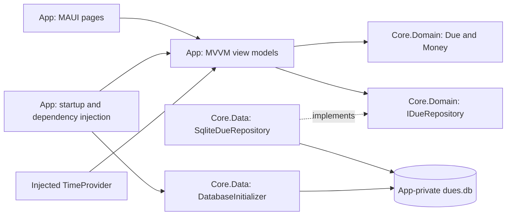

# Duewise - Software design

Authority: technical architecture and contracts supporting the [PRD](PRD.md). [DESIGN](DESIGN.md) owns visual/interaction standards; [STATUS](delivery/STATUS.md) owns delivery evidence; [TEST-PLAN](delivery/TEST-PLAN.md) owns execution procedures.

Source inspection: 2026-10-17, covering implementation that was uncommitted at the time and has since been committed through `7c22b4b`. This document describes inspected code unless explicitly labeled proposed or deferred. Reading source/tests is not runtime verification. The [previous SDD](delivery/SDD-2026-10-17.md) preserves the original review and history; the [migration record](delivery/DOCS-REFACTOR.md) maps all old sections.

## 1. Scope

Implement approved Android local CRUD using the existing Core domain/data and MAUI App boundaries. Preserve the [product rules](PRD.md#business-rules-and-validation); do not infer new features from schema placeholders or future design concepts. The repository/project names remain DueDateChecker; Duewise is the design/documentation brand.

## 2. Evidence boundaries

The original 2026-10-13 review described missing App wiring and an older UpdateAsync contract. Those observations are historical. Current App wiring, active-row update guards, and deletion handlers are described below. Test/build counts and phone acceptance are recorded only in delivery documentation.

[Project-file declarations](../src/DueDateChecker.App/DueDateChecker.App.csproj) establish Android-only targeting, ApplicationId `com.lem.duedatechecker`, display version 1.0, application version 1, minimum Android API 26, and XAML SourceGen. No global.json SDK pin is present. Historical installed SDK/workload versions and targetSdk observations remain in the plan/phase records; this review did not rebuild or inspect a new merged manifest.

## 3. Source boundaries

- [Core project](../src/DueDateChecker.Core/DueDateChecker.Core.csproj): domain and persistence in one assembly.
- [App composition root](../src/DueDateChecker.App/MauiProgram.cs): platform path, clock, and service registration.
- [Initializer](../src/DueDateChecker.Core/Data/DatabaseInitializer.cs), [connection factory](../src/DueDateChecker.Core/Data/SqliteConnections.cs), and [repository](../src/DueDateChecker.Core/Data/SqliteDueRepository.cs): persisted behavior.
- [Editor](../src/DueDateChecker.App/ViewModels/DueEditViewModel.cs), [list](../src/DueDateChecker.App/ViewModels/DuesListViewModel.cs), and [dispatcher](../src/DueDateChecker.App/Services/DatabaseDispatcher.cs): application state and operation ordering.

## 4. Architecture

| Project | Responsibility | Current configuration |
|---|---|---|
| src/DueDateChecker.Core | Domain values, repository abstraction, raw SQL implementation, embedded migrations | net10.0; Microsoft.Data.Sqlite 10.0.12 |
| src/DueDateChecker.App | Android UI, view models, navigation, database path, clock and DI wiring | net10.0-android; CommunityToolkit.Mvvm 8.4.2; MAUI Controls version from MauiVersion; Microsoft.Extensions.Logging.Debug 10.0.0 |
| tests/DueDateChecker.Core.Tests | Domain and repository behavior using temporary database files | xUnit; Core reference |
| tests/DueDateChecker.App.Tests | Platform-independent view-model and dispatcher behavior, including real SQLite persistence and controlled failures | net10.0; linked App sources, xUnit, CommunityToolkit.Mvvm; no MAUI runtime |

Both test projects target net10.0 and declare xUnit 2.9.3, xunit.runner.visualstudio 3.1.4, and Microsoft.NET.Test.Sdk 17.14.1. Core.Tests also declares coverlet.collector 6.0.4. App.Tests declares CommunityToolkit.Mvvm 8.4.2 and links App sources. These are project-file declarations, not a fresh dependency restore. The exact MAUI Controls version is supplied by the installed workload through `$(MauiVersion)`, not pinned in this repository.

Domain files must not depend on MAUI or SQLite types. Core.Data implements the domain repository interface. App is the composition root and may reference both Core namespaces. This folder boundary is currently a convention inside one assembly.

Keep the existing repository abstraction; v1 does not need a generic repository, server API, sync service, or notification scheduler. View models use CommunityToolkit.Mvvm ObservableObject and generated commands/properties. Page code handles navigation and dialog presentation, while view models handle validation, domain construction, and repository calls.

SQLite calls currently expose Task methods but execute synchronously underneath. Awaiting them alone does not guarantee a responsive UI. DatabaseDispatcher runs database initialization and repository work on a background task and serializes operations using SemaphoreSlim. View models await those operations and apply bound state changes on the UI context. The dispatcher holds no long-lived connection and introduces no SQLite types into Domain.

## 5. Data design

### 5.1 Domain types and mutation rules

Money is a readonly record struct containing `long Centavos`. FromCentavos rejects negatives. FromDecimal rejects negatives, multiplies by 100, rounds with MidpointRounding.AwayFromZero, and converts to long. Overflow must become a user validation error, including overflow during multiplication. ToString uses a fixed peso symbol and invariant `N2` formatting; for example, 245000 centavos displays as `₱2,450.00`.

Due is an immutable record containing Id, Title, Amount, DueDate, Notes, IsPaid, CreatedAt, UpdatedAt, and DeletedAt. Title validation also applies to a `with` edit. The App uses these mutation rules:

| Operation | State transition |
|---|---|
| Create | Due.Create generates a Guid, sets IsPaid=false and DeletedAt=null, and sets CreatedAt=UpdatedAt=now. |
| Edit or paid toggle | Copy the loaded active record with changed editable fields and UpdatedAt=now; preserve Id, CreatedAt, and DeletedAt. |
| Delete | SoftDeleteAsync sets DeletedAt=UpdatedAt=now, preserving other fields and the physical row. |

Obtain `now` from injected TimeProvider.GetUtcNow(). Store new App writes as UTC timestamps. The current mapper also accepts historical round-trip timestamps with nonzero offsets. Timestamp ordering is not a conflict-resolution algorithm; device clock changes can move UpdatedAt backwards. Future sync requires its own explicit policy.

DueDate remains DateOnly and must never be converted to UTC for persistence. The default date in a new form is today's date in Asia/Manila derived from the injected clock. The timezone provider belongs in App; Core receives the resulting DateOnly.

### 5.2 SQLite schema

The existing authoritative script is [001_create_dues.sql](../src/DueDateChecker.Core/Data/Migrations/001_create_dues.sql). Its user_version is 1.

| Column | SQLite type | Meaning |
|---|---|---|
| id | TEXT PRIMARY KEY | Guid formatted as standard text; assigned before insert. |
| title | TEXT NOT NULL | Trimmed, required domain title. |
| amount_centavos | INTEGER NOT NULL | Nonnegative signed 64-bit centavo value. |
| currency | TEXT NOT NULL DEFAULT 'PHP' | Fixed v1 currency; reserved for future evolution. |
| due_date | TEXT NOT NULL | Invariant `yyyy-MM-dd`; lexicographic order matches calendar order. |
| notes | TEXT nullable | Optional user text. |
| is_paid | INTEGER NOT NULL DEFAULT 0 | App writes 0 or 1. |
| timezone | TEXT NOT NULL DEFAULT 'Asia/Manila' | Fixed product timezone; reserved for later reminders/sync. |
| created_at | TEXT NOT NULL | DateTimeOffset round-trip `O` format. |
| updated_at | TEXT NOT NULL | Last mutation timestamp in the same format. |
| deleted_at | TEXT nullable | Null means active; a value is a tombstone. |

The schema has no CHECK constraints for nonnegative amounts, paid flags, or fixed currency/timezone. These rules are enforced by App/domain paths, not the database. Due validates title but does not validate identifier or timestamp relationships. Any future database constraints require a new migration.

Currency and timezone are not properties on the current Due record and are not mapped by SqliteDueRepository. Inserts obtain their SQL defaults; updates leave them untouched. They prepare storage for future work but do not implement multi-currency support or sync.

The partial index `ix_dues_active_due_date` indexes due_date where deleted_at is null. The current list order is due_date, then created_at. Equal values for both keys have no guaranteed relative order. Paid status is not a list filter.

### 5.3 Repository contracts

| Method | Behavior |
|---|---|
| ListActiveAsync() | Return all rows with DeletedAt=null, including paid rows, sorted by due_date and created_at. |
| GetAsync(Guid id) | Return a row including tombstones, or null for an unknown id. |
| AddAsync(Due due) | Insert the supplied record. Duplicate ids fail through SQLite. |
| UpdateAsync(Due due) | Update editable fields and UpdatedAt on active rows; preserve stored CreatedAt/DeletedAt. Throw KeyNotFoundException for an unknown or soft-deleted id. |
| SoftDeleteAsync(Guid id, DateTimeOffset when) | Set both deletion/update timestamps only on an active row. Unknown/already deleted ids are a no-op. |

All user values use SQL parameters. Each operation opens and disposes a connection; no connection is shared between view models. Each mutation is one atomic SQL statement. There are no cancellation-token parameters in the current interface; UI lifecycle cancellation must not be presented as cancellation of an already-running write.

Before saving an existing due, load it again and reject null or DeletedAt!=null. The read/check/update share one dispatcher operation. UpdateAsync additionally enforces `WHERE id = @id AND deleted_at IS NULL` and never writes deleted_at, preventing a stale edit from restoring a tombstone even when deletion occurs after the read. Multi-writer edit conflicts remain outside v1; a future sync design needs an explicit concurrency policy.

### 5.4 Initialization and migrations

App owns `Path.Combine(FileSystem.AppDataDirectory, "dues.db")` and supplies exactly the same path to DatabaseInitializer and SqliteDueRepository. Core never discovers platform directories.

Initialize once per process before any repository access. DatabaseInitializer opens/creates the file, reads PRAGMA user_version, loads embedded numbered SQL scripts, and applies each newer script in numeric order. Each script and its version bump share one transaction. Re-running initialization at version 1 is a no-op.

Add future changes as `002_*.sql`, `003_*.sql`, and so on; do not edit an already shipped migration. Migration failure blocks normal UI access and offers retry without deleting the database. The initializer now rejects negative/newer-than-supported user_version values without resetting the file; the newer-schema behavior is covered by a preservation test.

## 6. UI and navigation

### Design resource and layout mapping

The authorized [design adoption](../specs/design-adoption/spec.md) maps DESIGN theme pairs to `Resources/Styles/Colors.xaml` and component/type styles to `Styles.xaml`. MauiProgram registers four bundled Plus Jakarta Sans aliases; license/provenance are bundled under `Resources/Raw/Fonts`. ApplicationTitle changes to Duewise; ApplicationId and database path remain unchanged. App icon/splash use source SVG assets rather than an image-generation or icon-library runtime.

`Pages/PageLayout` applies DESIGN width breakpoints, margins and maximum readable width in logical units when page size changes. List header/actions scroll within CollectionView; cards and the editor stay single-column, and amounts wrap separately. Existing handlers retain ID-only edit navigation and mutation guards. The editor's Unfocused handlers call no-write field validation; Save revalidates, focuses the first invalid control and announces its error. Field border triggers show focus/error state; Android handler mappings remove redundant native underlines inside the outlines. Native day/night colors keep status-bar contrast consistent with the canvas. Paid/Unpaid badges keep literal status text.

The App contains Pages/DuesListPage and Pages/DueEditPage, with corresponding view models in ViewModels/. AppShell hosts the injected list root and registers the form route. App receives IServiceProvider and resolves Shell in CreateWindow, after InitializeComponent has loaded application resources; eagerly injecting Shell would construct the list before its StaticResource styles exist. The window retains Shell for its lifetime. The template MainPage is removed. Add opens a fresh form; selecting a row opens the same page in edit mode.

V1.2 navigates using only a due id and loads its data through the repository. No id means create mode; a supplied invalid id is unavailable and cannot become an insert. DueEditPage uses IQueryAttributable and observes its load command on appearance. Once loaded, repeated query/appearance events do not overwrite unsaved input. The following table includes the V1.3 deletion implementation; [STATUS](delivery/STATUS.md) distinguishes observed verification from remaining release acceptance.

| Screen | Bound state | Commands and behavior |
|---|---|---|
| DuesListPage | Active dues collection, IsBusy, error message, empty state | Load/refresh and Add; selecting a row opens edit mode. Each row shows title, formatted amount/date, and paid/unpaid text. |
| DueEditPage | Title, AmountText, selected date, Notes, IsPaid, create/edit mode, validation errors, IsBusy | Load, Save, Cancel; edit mode also offers Delete with confirmation through the page handler. Paid state is editable and persists on Save. |

Use a CollectionView for the list. Paid state must have a text indication; color alone is insufficient. Give fields and actions accessible labels. Save and delete controls are disabled during an operation, and refresh is prevented from overlapping another load. New dues default to unpaid; the paid control is introduced for existing dues in V1.2.

Reload the list when it appears after returning from the editor and when the app resumes on the list page. Do not append optimistic rows and then load them again. A successful repository write precedes navigation and visible success. If saving succeeds but navigation fails, retain the saved identity/state so retrying navigation cannot insert a duplicate.

Save flow:

1. Validate title, amount parsing/range, and date selection; show field errors without touching the database.
2. Convert amount through Money.FromDecimal; show the resulting peso value.
3. Capture one clock instant. In create mode, construct Due.Create; in edit mode, re-read the active record and copy editable fields.
4. Await AddAsync or UpdateAsync through the serialized background dispatcher.
5. On success, return to the list and reload it. On failure, keep form contents and present a retryable error.

Delete flow:

1. DueEditPage shows a native confirmation naming the original stored title. A page action guard prevents overlapping dialogs/actions. Cancel supplies false to the command and performs no storage call. Native Back/dismissal behavior remains an acceptance check; a false result is guarded independently in the view model.
2. On explicit confirmation, DeleteCommand checks that the target is an existing, loaded, available, incomplete record. It passes the id and one clock instant to SoftDeleteAsync through the dispatcher; it does not validate or save unfinished form values.
3. After successful completion, mark HasDeleted, return to the list, and reload. On failure, retain the page/input and allow a newly confirmed retry. Save/Delete are disabled during writes. After a navigation failure, HasCompleted provides Back to dues without repeating a mutation.

If confirmation display throws, the page reports an error without calling storage. The destructive button uses semantic overdue/surface colors, outline, and minimum dimensions from [DESIGN](DESIGN.md). The approved v1 scope has no Undo/restore interaction; the broader product design's Undo remains deferred.

Back/Cancel discards unsaved fields without writing. A deleted or unknown navigation target displays “This due is no longer available” with a return-to-list action. v1 has no recycle bin or restore command.

## 7. Dependency lifetimes and startup

| Registration | Lifetime | Reason |
|---|---|---|
| DatabaseInitializer | Singleton | One file path and an awaited startup initialization. |
| IDueRepository → SqliteDueRepository | Singleton | Holds only the path; connections are per operation. |
| TimeProvider.System | Singleton | One injectable clock source; tests substitute a fixed clock. |
| Database operation dispatcher | Singleton | Serializes initialization/reads/writes off the UI thread. |
| AppShell | Transient registration; resolved after app resources load and retained by the single Window | Root navigation container. |
| Pages and view models | Transient | Separate form state per navigation. |

The bootstrap sequence is: build DI registrations, display the list's startup/loading state, initialize SQLite in the dispatcher, then enable Add. The load task is awaited; startup errors remain visible and retry must complete initialization before Add becomes available. There is one Android window and no background writers in v1.

V1.1 implements this through an awaited list-load command: the list page initially displays loading state and disables Add until initialization completes. The page shares its load task across appearance/resume events. Lifecycle event handlers await the task; the view model catches initialization/read failures, displays a retry message, and keeps CRUD unavailable on startup failure.

## 8. Failure handling, privacy, and practical limits

The [PRD error/recovery requirements](PRD.md#error-and-recovery-requirements) own required outcomes. Implemented mechanisms are:

- DueEditViewModel validates fields before dispatch and catches conversion overflow; load/save/delete errors become bound messages and busy state is cleared in finally blocks.
- DatabaseDispatcher sets its initialized flag only after initialization succeeds, allowing a failed initialization to retry without deleting the file. DuesListViewModel blocks Add until initialization succeeds; a subsequent read failure retains ready state and any previous rows with an error.
- List results replace bound rows only after successful reads. An already-loaded editor does not overwrite unsaved input on repeated load requests.
- Missing/deleted targets are rejected on load/save; repository update guards also protect against deletion after the App read.
- SavedDueId/HasDeleted retain successful mutation state across return-navigation failure; repeated mutation commands are guarded.
- SQLite commits remain authoritative after process termination. Unsaved form recovery, database repair, and automatic downgrade/reset are not implemented.

SQLite is the source of truth. There is no export, account restore, or server backup in v1. App-private storage and `android:allowBackup="false"` are configured, but this is ordinary SQLite without application-level encryption. Uninstalling or clearing app data loses dues; soft deletion preserves a row only while the database remains present.

Do not log titles, amounts, notes, raw SQL parameters, or signing passwords. Keep keystores outside the repository and local.signing.props ignored. The existing Android manifest retains template INTERNET and ACCESS_NETWORK_STATE permissions; no v1 functionality should make network calls. Removing unused permissions can be considered during release cleanup.

## Requirement-to-component mapping

Requirement definitions and product acceptance outcomes remain in the [PRD](PRD.md#approved-requirements).

| IDs | Components / contracts | Verification boundary |
|---|---|---|
| R01 | App project, conditional local signing import, Android manifest, App/CreateWindow and Shell | Release/signing/launcher checks; historical build is not current signing evidence. |
| R02 | DueEditPage, DueEditViewModel, Due.Create, Money, AddAsync, dispatcher | Domain/Core/App tests plus native create/restart. |
| R03 | DuesListPage/ViewModel, DueListItem, ListActiveAsync and partial index | Repository/list tests plus native order/empty/refresh checks. |
| R04, R05 | ID-only navigation, editor load/save, immutable copy, guarded UpdateAsync | Edit/reopen/race tests plus native edit/paid/restart. |
| R06 | Page confirmation, DeleteCommand, SoftDeleteAsync, active filtering | [Soft-delete plan](../specs/v1.3-soft-delete/plan.md), delete tests, native confirmation/tombstone checks. |
| R07 | App-private SQLite and local operations; no account/server dependency | Offline phone procedures for all CRUD paths. |
| R08 | `.github/workflows/ci.yml` runs the Core and App test projects on a Linux runner on every push ([V1.4 plan](../specs/v1.4-ci/plan.md)) | Observed passing GitHub run, recorded in STATUS. |

## Verification strategy

Use domain/Core tests for invariants and SQL behavior, the linked-source App harness for view-model/dispatcher behavior, and the Android Release build/device for XAML, handlers, navigation, lifecycle, and trimming. The [test plan](delivery/TEST-PLAN.md) owns commands, coverage inventory, gaps, and acceptance procedures. Recorded results belong in [STATUS](delivery/STATUS.md) and phase evidence, not this contract document.

## Deferred extension points

- Notifications require a separate scheduler, exactness/fan-out policy, reconciliation, permission handling, and tap navigation design. DateOnly plus timezone storage does not implement scheduling.
- Authentication/sync require explicit outbox, ownership, conflict-resolution, RLS, and token-storage contracts. Guid identities and tombstones alone do not provide synchronization. Multi-writer edits are outside v1.
- SQLCipher/encryption and backup/export have no approved implementation decision; review privacy/data-loss tradeoffs before extending storage.
- Distribution is sideloaded APK for v1. Play signing and current platform/store requirements need separate review when that scope begins.

The [ADR index](adr/README.md) explains absent legacy ADR references and how to record supported decisions without inventing rationale. Learner checkpoints are preserved in historical notes; implementation authorization is not demonstrated understanding.

## Implementation references

The following links are retained from the prior SDD for reference; their contents and current platform guidance were not revalidated during this documentation refactor.

- [MAUI dependency injection](https://learn.microsoft.com/en-us/dotnet/maui/fundamentals/dependency-injection?view=net-maui-10.0): constructor injection and transient pages/view models.
- [MAUI DatePicker](https://learn.microsoft.com/en-us/dotnet/maui/user-interface/controls/datepicker?view=net-maui-10.0): nullable date binding in .NET 10.
- [MVVM Toolkit commands](https://learn.microsoft.com/en-us/dotnet/communitytoolkit/mvvm/generators/relaycommand): generated async commands and CanExecute notifications.
- [MAUI Shell navigation](https://learn.microsoft.com/en-us/dotnet/maui/fundamentals/shell/navigation?view=net-maui-10.0): id query handling through IQueryAttributable.
- [CollectionView selection](https://learn.microsoft.com/en-us/dotnet/maui/user-interface/controls/collectionview/selection?view=net-maui-10.0): selection events and clearing SelectedItem for repeated navigation.
- [MAUI DisplayAlertAsync](https://learn.microsoft.com/en-us/dotnet/api/microsoft.maui.controls.page.displayalertasync?view=net-maui-10.0): native confirmation returning an explicit Boolean choice.
