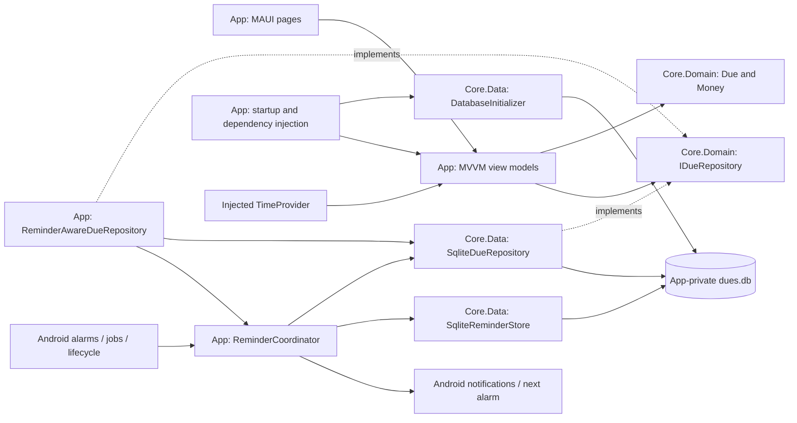

# Duewise - Software design

Authority: technical architecture and contracts supporting the [PRD](PRD.md). [DESIGN](DESIGN.md) owns visual/interaction standards; [STATUS](delivery/STATUS.md) owns delivery evidence; [TEST-PLAN](delivery/TEST-PLAN.md) owns execution procedures.

Source inspection: 2026-10-18, including F01 Details, F02 saved-data Dashboard, F03 Calendar, the F07 category slice and F05 reminders. The original implementation baseline was committed through `7c22b4b`; subsequent design adoption, navigation and production extensions are working-tree changes linked from STATUS. Descriptions are inspected code unless labeled proposed/deferred; source inspection is not runtime acceptance. The [previous SDD](delivery/SDD-2026-10-17.md) preserves original history; the [migration record](delivery/DOCS-REFACTOR.md) maps old sections. A 2026-11-05 documentation-only inspection relabeled the F07 optional-amount contract as planned, not implemented; the 2026-11-06 implementation of that slice (schema 4, nullable `Due.Amount`) is described in §5 and the [F07 optional amount contract](#f07-optional-amount-contract). The 2026-11-05 Focus adoption changed Shell, the Android renderer, page layout and the editor; §6 describes the new code. UX Wave 2 (2026-11-06) added schema 5 and the [F07 recurrence contract](#f07-recurrence-contract), hardened the migration runner (§5.4) and added maker-specific reminder steps to the [F05 contract](#f05-reminder-contract). UX Wave 3 (2026-11-06) added the [UX05 export and import contract](#ux05-export-and-import-contract). UX Wave 4 (2026-11-06) added the [UX06 confirmation and Undo contract](#ux06-confirmation-and-undo-contract) and the UX07/UX08/UX10–UX12 presentation changes in §6. UX Wave 5 (2026-11-07) added the UX13–UX16 sizing rules (`LayoutRules`) in §6.

## 1. Scope

Implement approved Android local CRUD using the existing Core domain/data and MAUI App boundaries. Preserve the [product rules](PRD.md#business-rules-and-validation); do not infer new features from schema placeholders or future design concepts. Repository/project names and Android package identity remain DueDateChecker; the app's display, icon, splash and shell identity adopt Duewise through the [design-adoption plan](../specs/design-adoption/plan.md).

## 2. Evidence boundaries

The original 2026-10-13 review described missing App wiring and an older UpdateAsync contract. Those observations are historical. Current App wiring, active-row update guards, and deletion handlers are described below. Test/build counts and phone acceptance are recorded only in delivery documentation.

[Project-file declarations](../src/DueDateChecker.App/DueDateChecker.App.csproj) establish Android-only targeting, ApplicationId `com.lem.duedatechecker`, display version 1.0, application version 1, minimum Android API 26, and XAML SourceGen. No global.json SDK pin is present. Historical installed SDK/workload versions remain in the plan/phase records; later design-adoption build/merged-manifest observations are recorded separately in [execution evidence](delivery/evidence/DESIGN-ADOPTION-2026-10-17.md#automated-and-build-evidence).

## 3. Source boundaries

- [Core project](../src/DueDateChecker.Core/DueDateChecker.Core.csproj): domain and persistence in one assembly.
- [App composition root](../src/DueDateChecker.App/MauiProgram.cs): platform path, clock, and service registration.
- [Initializer](../src/DueDateChecker.Core/Data/DatabaseInitializer.cs), [connection factory](../src/DueDateChecker.Core/Data/SqliteConnections.cs), and [repository](../src/DueDateChecker.Core/Data/SqliteDueRepository.cs): persisted behavior.
- [Editor](../src/DueDateChecker.App/ViewModels/DueEditViewModel.cs), [list](../src/DueDateChecker.App/ViewModels/DuesListViewModel.cs), and [dispatcher](../src/DueDateChecker.App/Services/DatabaseDispatcher.cs): application state and operation ordering.

## 4. Architecture

| Project | Responsibility | Current configuration |
|---|---|---|
| src/DueDateChecker.Core | Domain values, repository abstraction, raw SQL implementation, embedded migrations | net10.0; Microsoft.Data.Sqlite 10.0.12 |
| src/DueDateChecker.App | Android UI, view models, navigation, database path, clock and DI wiring | net10.0-android; CommunityToolkit.Mvvm 8.4.2; MAUI Controls version from MauiVersion; Microsoft.Extensions.Logging.Debug 10.0.0 |
| tests/DueDateChecker.Core.Tests | Domain and repository behavior using temporary database files | xUnit; Core reference |
| tests/DueDateChecker.App.Tests | Platform-independent view-model and dispatcher behavior, including real SQLite persistence and controlled failures | net10.0; linked App sources, xUnit, CommunityToolkit.Mvvm; no MAUI runtime |

Both test projects target net10.0 and declare xUnit 2.9.3, xunit.runner.visualstudio 3.1.4, and Microsoft.NET.Test.Sdk 17.14.1. Core.Tests also declares coverlet.collector 6.0.4. App.Tests declares CommunityToolkit.Mvvm 8.4.2 and links App sources. These are project-file declarations, not a fresh dependency restore. The exact MAUI Controls version is supplied by the installed workload through `$(MauiVersion)`, not pinned in this repository.

Domain files must not depend on MAUI or SQLite types. Core.Data implements the domain repository interface. App is the composition root and may reference both Core namespaces. This folder boundary is currently a convention inside one assembly.

Keep the existing repository abstraction; v1 does not need a generic repository, server API or sync service. The separately authorized F05 reminder coordinator and platform boundary are described below. View models use CommunityToolkit.Mvvm ObservableObject and generated commands/properties. Page code handles navigation and dialog presentation, while view models handle validation, domain construction, and repository calls.

SQLite calls currently expose Task methods but execute synchronously underneath. Awaiting them alone does not guarantee a responsive UI. DatabaseDispatcher runs database initialization and repository work on a background task and serializes operations using SemaphoreSlim. View models await those operations and apply bound state changes on the UI context. The dispatcher holds no long-lived connection and introduces no SQLite types into Domain.

## 5. Data design

### 5.1 Domain types and mutation rules

Money is a readonly record struct containing `long Centavos`. FromCentavos rejects negatives. FromDecimal rejects negatives, multiplies by 100, rounds with MidpointRounding.AwayFromZero, and converts to long. Overflow must become a user validation error, including overflow during multiplication. ToString uses a fixed peso symbol and invariant `N2` formatting; for example, 245000 centavos displays as `₱2,450.00`. The same format is exposed as `Money.Format(decimal pesos)` for display figures that are not one stored amount; the Dashboard upcoming total sums in `decimal` and uses it, because two amounts at the largest allowed value overflow a `long` (found 2026-11-06).

Due is an immutable record containing Id, Title, Amount, DueDate, Notes, IsPaid, CreatedAt, UpdatedAt, DeletedAt, validated DueCategory and, since schema 5, Repeat, RepeatDay and RepeatSourceId. Title, category and repeat-code validation also apply to a `with` edit. Amount is `Money?` (null = no amount); `Due.Create` and the public `Due.Validate()` enforce the cross-field [F07 optional-amount rule](#f07-optional-amount-contract) and the [recurrence rules](#f07-recurrence-contract). The App uses these mutation rules:

| Operation | State transition |
|---|---|
| Create | Due.Create generates a Guid, sets IsPaid=false and DeletedAt=null, and sets CreatedAt=UpdatedAt=now. |
| Edit or paid toggle | Copy the loaded active record with changed editable fields and UpdatedAt=now; preserve Id, CreatedAt, DeletedAt and RepeatSourceId. Marking a repeating due paid also inserts its next occurrence in the same transaction ([F07 recurrence contract](#f07-recurrence-contract)). |
| Delete | SoftDeleteAsync sets DeletedAt=UpdatedAt=now, preserving other fields and the physical row. |
| Undo after Delete (UX06) | RestoreAsync clears DeletedAt and sets UpdatedAt=now only if the row is still deleted at the exact stamp that Delete wrote; every other field stays. |

Obtain `now` from injected TimeProvider.GetUtcNow(). Store new App writes as UTC timestamps. The current mapper also accepts historical round-trip timestamps with nonzero offsets. Timestamp ordering is not a conflict-resolution algorithm; device clock changes can move UpdatedAt backwards. Future sync requires its own explicit policy.

DueDate remains DateOnly and must never be converted to UTC for persistence. The default date in a new form is today's date in Asia/Manila derived from the injected clock. For due creation the timezone provider belongs in App; Core Due receives the resulting DateOnly. The separately pure F05 planner receives an explicit TimeZoneInfo argument from App.

### 5.2 SQLite schema

Schema 1 is defined by immutable [001_create_dues.sql](../src/DueDateChecker.Core/Data/Migrations/001_create_dues.sql); [002_add_category.sql](../src/DueDateChecker.Core/Data/Migrations/002_add_category.sql) advances user_version to 2. [003_add_reminders.sql](../src/DueDateChecker.Core/Data/Migrations/003_add_reminders.sql) adds reminder settings/journal tables and advances user_version to 3 without changing dues. [004_optional_amounts.sql](../src/DueDateChecker.Core/Data/Migrations/004_optional_amounts.sql) rebuilds dues with a nullable amount and advances user_version to 4; see the [F07 optional amount contract](#f07-optional-amount-contract). [005_recurrence.sql](../src/DueDateChecker.Core/Data/Migrations/005_recurrence.sql) adds the three repeat columns and their index and advances user_version to 5; see the [F07 recurrence contract](#f07-recurrence-contract). Current user_version is 5.

| Column | SQLite type | Meaning |
|---|---|---|
| id | TEXT PRIMARY KEY | Guid formatted as standard text; assigned before insert. |
| title | TEXT NOT NULL | Trimmed, required domain title. |
| amount_centavos | INTEGER (nullable since schema 4) | Nonnegative signed 64-bit centavo value. Zero is a distinct explicit amount; NULL means no amount (Task/Other only, app-enforced). Schemas 1–3 declared it NOT NULL. |
| currency | TEXT NOT NULL DEFAULT 'PHP' | Fixed v1 currency; reserved for future evolution. |
| due_date | TEXT NOT NULL | Invariant `yyyy-MM-dd`; lexicographic order matches calendar order. |
| notes | TEXT nullable | Optional user text. |
| is_paid | INTEGER NOT NULL DEFAULT 0 | App writes 0 or 1. |
| timezone | TEXT NOT NULL DEFAULT 'Asia/Manila' | Fixed product timezone; F05 uses the approved Manila zone rather than a per-row preference. |
| created_at | TEXT NOT NULL | DateTimeOffset round-trip `O` format. |
| updated_at | TEXT NOT NULL | Last mutation timestamp in the same format. |
| deleted_at | TEXT nullable | Null means active; a value is a tombstone. |
| category | INTEGER NOT NULL DEFAULT 0, CHECK IN (0,1,2,3) | Stable DueCategory code; legacy rows become Other. |
| repeat_rule | INTEGER NOT NULL DEFAULT 0, CHECK IN (0,1,2,3) | Stable RepeatRule code (since schema 5): 0 Never, 1 Weekly, 2 Monthly, 3 Yearly. Older rows read as Never. |
| repeat_day | INTEGER nullable, CHECK BETWEEN 1 AND 31 | Anchor day of month for Monthly/Yearly; NULL otherwise (app-enforced pairing). |
| repeat_source_id | TEXT nullable | Id of the due this occurrence was generated from; never rewritten by updates. |

The category, repeat_rule and repeat_day columns are constrained; the other columns have no CHECK constraints for nonnegative amounts, paid flags, or fixed currency/timezone. These rules are enforced by App/domain paths, not the database. The category-dependent amount requirement is also application-enforced: Bill/Subscription must have an amount, while Task/Other may store NULL. Due validates title/category and the amount requirement but does not validate identifier or timestamp relationships. Any future database constraints require a new migration.

Currency and timezone are not properties on the current Due record and are not mapped by SqliteDueRepository. Inserts obtain their SQL defaults; updates leave them untouched. They prepare storage for future work but do not implement multi-currency support or sync.

The partial index `ix_dues_repeat_source` indexes repeat_source_id where it is not null and serves the one-occurrence-per-source check. The partial index `ix_dues_active_due_date` indexes due_date where deleted_at is null. The current list order is due_date, then created_at. Equal values for both keys have no guaranteed relative order. Paid status is not a list filter.

### 5.3 Repository contracts

| Method | Behavior |
|---|---|
| ListActiveAsync() | Return all rows with DeletedAt=null, including paid rows, sorted by due_date and created_at. |
| GetAsync(Guid id) | Return a row including tombstones, or null for an unknown id. |
| AddAsync(Due due) | Insert the supplied record. Duplicate ids fail through SQLite. |
| UpdateAsync(Due due) | Update editable fields and UpdatedAt on active rows; preserve stored CreatedAt/DeletedAt. Throw KeyNotFoundException for an unknown or soft-deleted id. |
| SoftDeleteAsync(Guid id, DateTimeOffset when) | Set both deletion/update timestamps only on an active row. Unknown/already deleted ids are a no-op. |
| RestoreAsync(Guid id, DateTimeOffset deletedAt, DateTimeOffset now) | UX06: `UPDATE … SET deleted_at = NULL, updated_at = @now WHERE id = @id AND deleted_at = @deletedAt`, comparing the stored "O" text. Returns false (no change) for an active, unknown or differently stamped row. The interface default throws, so every storage implementation must provide it. |
| UpdateWithNextAsync(Due updated, Due next) | Save `updated` like UpdateAsync and insert `next` (linked to it) in one transaction; return false when an occurrence from the same source already exists, in which case only the update is saved. See the [F07 recurrence contract](#f07-recurrence-contract). |

All user values use SQL parameters. Each operation opens and disposes a connection; no connection is shared between view models. Each mutation is one atomic SQL statement, except UpdateWithNextAsync, whose two statements share one transaction. There are no cancellation-token parameters in the current interface; UI lifecycle cancellation must not be presented as cancellation of an already-running write.

Before saving an existing due, load it again and reject null or DeletedAt!=null. The read/check/update share one dispatcher operation. UpdateAsync additionally enforces `WHERE id = @id AND deleted_at IS NULL` and never writes deleted_at, preventing a stale edit from restoring a tombstone even when deletion occurs after the read. Multi-writer edit conflicts remain outside v1; a future sync design needs an explicit concurrency policy.

### 5.4 Initialization and migrations

App owns `Path.Combine(FileSystem.AppDataDirectory, "dues.db")` and supplies exactly the same path to DatabaseInitializer and SqliteDueRepository. Core never discovers platform directories.

Initialize once per process before any repository access. DatabaseInitializer opens/creates the file, reads PRAGMA user_version, loads embedded numbered SQL scripts, and applies each newer script in numeric order. Each script and its version bump share one transaction. Re-running initialization at the current version 5 is a no-op.

The runner executes a script with `ExecuteReader` and steps through every result with `NextResult()`, not `ExecuteNonQuery`. With Microsoft.Data.Sqlite 10.0.12, a statement that reports result columns (a SELECT, and also `ALTER TABLE … ADD COLUMN` with a CHECK, as in migrations 002 and 005) makes `ExecuteNonQuery` run the remaining statements while disposing its reader, where their errors are discarded. A failing later statement could then commit a half-applied migration with its version bumped. Found and fixed 2026-11-06 while testing migration 005; `RecurrenceTests.Failure_after_the_columns_were_added_rolls_back_to_schema_four` is the regression test.

Category migration 002, reminder migration 003, optional-amount migration 004 and recurrence migration 005 are present; add future changes as `006_*.sql` and later, and do not edit an already shipped migration. Migration 004 uses SQLite's table-rebuild pattern because the old column was `NOT NULL`: create `dues_v4`, copy every stored column plus `rowid`, drop the old table, rename the replacement and recreate `ix_dues_active_due_date`. All of it shares the initializer's single transaction with the version bump. Migration failure blocks normal UI access and offers retry without deleting the database. The initializer rejects negative/newer-than-supported user_version values without resetting the file; the newer-schema behavior is covered by a preservation test.

### F07 category contract

[DueCategory](../src/DueDateChecker.Core/Domain/DueCategory.cs) persists stable codes Other=0, Bill=1, Task=2, Subscription=3. Due validates enum values on construction/create/with; the optional constructor/factory argument defaults to Other for backward-compatible callers. App's new editor explicitly defaults to Bill. [Migration 002](../src/DueDateChecker.Core/Data/Migrations/002_add_category.sql) adds the NOT NULL constrained column with default 0, including tombstones, without rebuilding rows or changing old timestamps/values. Never edit 001 or 002; F05 later advances the schema to 3 and the F07 optional-amount slice advances it to 4. Failed migration/version bump remains transactional and retryable without resetting data.

SqliteDueRepository includes category in SELECT/parameterized INSERT/UPDATE and maps its integer through domain validation. Null/unknown database values fail reads; no silent fallback. Active-row update and soft-delete preservation guards remain unchanged. Category does not affect sort/status/count queries; no category index or repository query API is needed.

DueEditViewModel exposes a fixed read-only category list, nullable draft selection, shared blur/Save validation, loaded saved value and captured category in guarded Save. Delete still ignores draft edits. Native Picker/field-error focus follows existing outlined controls and CanEdit. DueListItem/DashboardItem project literal category text/semantics for all saved-data pages. Dashboard category choice ANDs with title/status inside the existing stable observable collection; it does not replace ItemsSource or its persistent header. Clear resets all three constraints; summaries remain unfiltered. No extra service, preference store or navigation route is introduced. [PRD](PRD.md#f07-category-rules) owns user behavior.

### F07 optional amount contract

**Status, source inspection 2026-11-06: implemented.** The contract below was written on 2026-11-03 and implemented on 2026-11-06 ([tasks](../specs/f07-optional-amounts/tasks.md), [evidence](delivery/evidence/F07-OPTIONAL-AMOUNTS-2026-11-06.md)). The 2026-11-05 "planned" label is superseded.

[PRD optional amount rules](PRD.md#f07-optional-amount-rules) and [OA01-OA06](../specs/f07-optional-amounts/spec.md#acceptance-scenarios) govern this slice. [`Due.Amount`](../src/DueDateChecker.Core/Domain/Due.cs) is `Money?`; `Money` still rejects negative values and owns centavo rounding/formatting. `Due.RequiresAmount(category)` is true for Bill/Subscription. `Due.Create` and public `Due.Validate()` reject a null amount for Bill/Subscription and accept null for Task/Other. The rule is not in an init accessor because a `with` expression assigns properties one at a time and would observe a half-changed record; `Validate()` checks the finished record instead. `SqliteDueRepository` maps SQL NULL to null and writes `DBNull.Value`; `AddAsync`/`UpdateAsync` call `Validate()` before SQL so an invalid copied record cannot be persisted. The repository otherwise keeps its parameterized insert/update, active-row guard, sorting and tombstone behavior.

`004_optional_amounts.sql` rebuilds `dues` to make `amount_centavos` nullable. The replacement preserves all existing columns/defaults/category CHECK and column order, copies rows including tombstones and their `rowid`, drops the old table, renames the replacement and recreates the partial active-date index with identical SQL, so the list query plan is unchanged. Existing values, timestamps and identities are not rewritten. SQLite does not enforce the category-dependent requirement; this is consistent with the existing application-enforced amount/timestamp limitations.

Editor and projection behavior: DueEditViewModel exposes `IsAmountRequired`, `AmountRequirementText`, `AmountPlaceholder`, `AmountDescription` and `AmountPreviewDescription` from the selected category (a missing or undefined category counts as required), validates blank as absent only for Task/Other, and previews "No amount" for an optional blank. Changing the category re-validates the amount only while an amount error is shown, so a blank error clears for Task/Other and no new error appears before blur or Save. Save passes `Money?`; loading a null amount produces blank text. `DueListItem.NoAmountText` ("No amount") is returned for null by DueListItem/DashboardItem and included in accessibility text; Details and Calendar reuse those projections. The Dashboard upcoming total adds known amounts only and appends "· {n} without an amount, excluded" when any unpaid due in the window has none. F05 planning ignores amount and notification payloads remain generic. No new totals, statistics or inferred amounts are introduced. [DESIGN](DESIGN.md#f07-optional-amount-adaptation) owns presentation.

### F07 recurrence contract

**Status, source inspection 2026-11-06: implemented** ([tasks](../specs/f07-recurrence/tasks.md), [evidence](delivery/evidence/UX-WAVE2-2026-11-06.md)). [PRD UX03](PRD.md#ux-review-decisions-2026-11-06) and [RC01–RC08](../specs/f07-recurrence/spec.md#acceptance-scenarios) govern behavior; [ADR 009](adr/009-recurring-dues.md) records the storage and consistency choices.

Domain: [`RepeatRule`](../src/DueDateChecker.Core/Domain/RepeatRule.cs) persists Never=0, Weekly=1, Monthly=2, Yearly=3; undefined codes fail on construction, `with` and read. `Due.CanRepeat(category)` is true for Bill and Subscription only. `Due.Validate()` rejects a repeat on Task/Other, Monthly/Yearly without an anchor day 1–31, and an anchor on Never/Weekly. `Due.Create(..., repeat)` sets the anchor from the due date. [`Recurrence`](../src/DueDateChecker.Core/Domain/Recurrence.cs) owns the date rules: `NextDate` adds 7 days for Weekly, and moves Monthly/Yearly to the anchor day in the next month/year, clamped to that month's length; no next date exists past 31 Dec 9999. `NextOccurrence` copies title, amount, notes, category, repeat and anchor into a new unpaid due created now and linked through `RepeatSourceId`. `NextOnPayment(current, saved, now)` returns that occurrence only for an unpaid → paid change. `AnchorAfterEdit` keeps the stored anchor while the due date is unchanged and otherwise takes the new date's day.

Storage: migration 005 is additive (three `ALTER TABLE … ADD COLUMN` statements plus the partial source index); existing rows read as Never with no anchor or source. `UpdateWithNextAsync` validates both records and requires `next.RepeatSourceId == updated.Id`. It then runs the guarded UPDATE (0 rows throws KeyNotFoundException and rolls back) and `INSERT … SELECT … WHERE NOT EXISTS (SELECT 1 FROM dues WHERE repeat_source_id = @source)` in one transaction, returning whether a row was inserted. Any row with that source, including a tombstone, blocks a second insert. `UpdateAsync` never writes `repeat_source_id`. `IDueRepository` supplies a non-transactional default (update, then add) only so wrappers and test doubles compile; `SqliteDueRepository` overrides it, and [ReminderAwareDueRepository](../src/DueDateChecker.App/Services/ReminderAwareDueRepository.cs) forwards it and requests one reconciliation, which re-plans every due including the new one.

App: the Details payment toggle and the editor's Save re-read the due inside the dispatcher gate. When `NextOnPayment` yields an occurrence they call `UpdateWithNextAsync`; otherwise `UpdateAsync`. Details shows and announces "Next one added for dd MMM yyyy." only when a row was inserted; the editor announces "Saved. Next one added for …" before returning. DueEditViewModel exposes `Repeats`, `SelectedRepeat` (nullable; null saves as Never), `CanChooseRepeat` and `RepeatHelpText`. Changing the type to Task/Other resets the repeat to Never, and Save forces Never for a type that cannot repeat. `DueListItem` adds `IsRepeating`, `RepeatFactText` and the repeat in `MetaText` and accessibility text, which `DashboardItem` and Calendar reuse. Export (UX05) must carry the three columns. [DESIGN](DESIGN.md#ux-review-decisions-2026-11-06) owns presentation.

### UX05 export and import contract

**Status, source inspection 2026-11-06: implemented** ([tasks](../specs/f04-export-import/tasks.md), [evidence](delivery/evidence/UX-WAVE3-2026-11-06.md)). [PRD UX05](PRD.md#ux-review-decisions-2026-11-06) and [EX01–EX08](../specs/f04-export-import/spec.md#acceptance-scenarios) govern behavior; [ADR 010](adr/010-export-import-file.md) records the choices.

Core (`Data/`): [`DueRecord`](../src/DueDateChecker.Core/Data/DueRecord.cs) is one `dues` row with its fifteen stored columns, as stored, including currency, timezone and the timestamp strings. [`DueArchive`](../src/DueDateChecker.Core/Data/DueArchive.cs) owns format `duewise.dues` version 1 and `MaxBytes` (5 MB).

- `Write(records, exportedAt)` emits indented UTF-8 JSON with `Utf8JsonWriter`; letters in any script stay unescaped.
- `Read(bytes)` refuses oversize input, skips a UTF-8 byte order mark and parses with `JsonDocument` (comments and trailing commas rejected, depth 8). It checks `format`, then `version` (higher → `NewerVersion`, lower or non-integer → `NotAnExport`), then the exact top-level and per-due field sets with JSON types and no repeated names.
- `Validate(records)`, also called by the store, checks each record with the domain (`Due` construction and `Validate()`) plus GUID, date and `O`-timestamp parsing, rejects repeated ids and empty files, and normalizes ids to the app's lower-case form and titles to trimmed text.
- Problems surface as `DueArchiveException` with `DueArchiveProblem`, 1-based `DueNumber` and the file's `Field` name; it holds no user data.
- Reflection-based `JsonSerializer` is not used because the trimmed Android Release build disables it.

[`SqliteDueArchive`](../src/DueDateChecker.Core/Data/SqliteDueArchive.cs) implements `IDueArchiveStore`:

- `ReadAllAsync` returns every row in rowid order.
- `CountActiveAsync` counts rows with `deleted_at IS NULL`.
- `ImportAsync` validates, opens one IMMEDIATE transaction, refuses with `AppNotEmpty` when any row is active, and upserts each record with `ON CONFLICT (id) DO UPDATE … WHERE dues.deleted_at IS NOT NULL`. A change count other than 1 aborts as `AppNotEmpty`, and any exception rolls back every row. Schema and migrations are unchanged.

App: [`IDueFileService`](../src/DueDateChecker.App/Services/IDueFileService.cs) is the system dialogs. [`AndroidDueFileService`](../src/DueDateChecker.App/Platforms/Android/AndroidDueFileService.cs) uses `ACTION_CREATE_DOCUMENT` (type `application/json`, suggested title) and `ACTION_OPEN_DOCUMENT` (JSON, text or octet-stream). It keeps one pending `TaskCompletionSource` per dialog, completed from MAUI's Android `OnActivityResult` lifecycle event (registered in MauiProgram). It writes or reads through `ContentResolver` streams, reading at most `maxBytes + 1`.

[`DataTransferViewModel`](../src/DueDateChecker.App/ViewModels/DataTransferViewModel.cs) runs storage calls through DatabaseDispatcher and guards repeated taps with `IsBusy`:

- `ExportCommand` reads every row, writes the file named `duewise-dues-{Manila date}.json` and reports counts, cancel or failure.
- `ChooseImportFileCommand` refuses before the dialog while dues show, then reads and validates the file and prepares `ImportConfirmationMessage`.
- `ImportCommand(confirmed)` writes through the store, which checks emptiness again, then calls `ReminderCoordinator.AfterImport()` to request reconciliation.
- All refusal and failure texts live here.

SettingsPage hosts the "Your data" card, binds it to this view model, shows the confirmation alert and announces each result. Nothing is logged or cached; reminder settings and preferences are not exported.

### UX06 confirmation and Undo contract

**Status, source inspection 2026-11-06: implemented** ([tasks](../specs/ux06-confirmations-undo/tasks.md), [evidence](delivery/evidence/UX-WAVE4-2026-11-06.md)). [PRD UX06](PRD.md#ux-review-decisions-2026-11-06) and [CM01–CM08](../specs/ux06-confirmations-undo/spec.md#acceptance-scenarios) govern behavior.

[`IMessageHost`](../src/DueDateChecker.App/Services/IMessageHost.cs) shows a message for about 3 s (`Show`) or with an Undo action for 5 s (`ShowUndo`); a new message replaces the current one. [`AndroidMessageHost`](../src/DueDateChecker.App/Platforms/Android/AndroidMessageHost.cs) builds a Material `Snackbar` on the activity's content view, so a message survives the editor closing:

- It is posted after layout and anchored to the bottom bar's dock when the bar shows, otherwise placed at the bottom edge.
- Colours: `TextLight` background with `SurfaceLight` text and `PrimaryDark` action in light mode, inverted in dark mode. Corners are 14 dp, the font is Jakarta Medium with Material's letter spacing and capitals removed, and text runs to up to four lines.
- Material announces the text through a polite live region and lengthens an action's time when the user has set a longer accessibility timeout. Callers therefore do not announce messages themselves.

Messages come from view models only on success:

- `DueEditViewModel.CompletionMessage`: "Due saved.", "Changes saved." or "Saved. Next one added for …".
- `DueEditViewModel.Deletion`: a `DueDeletion` (id and the exact stamp passed to `SoftDeleteAsync`).
- `DueDetailViewModel.PaymentAnnouncement`.
- Failures and cancels leave them empty.

The editor shows its message after `ReturnToParentAsync`, so it sits above the bar the parent page restores. Details shows its message after the toggle and keeps announcing failures inline as before.

[`DeletionUndo`](../src/DueDateChecker.App/Services/DeletionUndo.cs) is a singleton:

- `Offer` remembers only the latest deletion and shows "Due deleted." with Undo.
- `UndoAsync` acts once and only for that latest offer. It runs `RestoreAsync` inside DatabaseDispatcher and reports one of: "Due restored.", "Nothing to undo." (repeated, replaced or stamp no longer matching), or "Couldn't undo. The due stays deleted." (exception; the tombstone stays).
- On success it raises `Restored`. AppShell then reloads the page on screen on the UI thread: Details through `RefreshAfterRestoreAsync`, which re-prepares an unavailable target, and the other pages through `RefreshCurrentPageAsync`.

`ReminderAwareDueRepository.RestoreAsync` forwards and, when a row was restored, calls `AfterWrite` so reminders are planned again. The guard by exact stamp keeps an Undo from reversing a later deletion, and `UpdateAsync` still refuses tombstones, so a stale edit cannot revive a due.

## 6. UI and navigation

### F04 preference contract

[PRD preferences](PRD.md#f04-preference-rules) and [PF01-PF07](../specs/f04-preferences/spec.md#acceptance-scenarios) govern behavior. [AppPreferencesService](../src/DueDateChecker.App/Services/AppPreferencesService.cs) is a foreground UI-thread singleton with immutable current values, strict versioned encoding and a Changed event. [MauiAppPreferencesStorage](../src/DueDateChecker.App/Services/MauiAppPreferencesStorage.cs) adapts MAUI Preferences; one key `duewise.preferences.v1` stores `1|system|monday` or the supported alternatives. Missing means System/Monday. Read/decode errors retain last good/default state without rewriting storage. Save validates and writes the entire pair before publishing it; failed writes do not publish. This is one platform-preference write, not a SQLite transaction or guaranteed durability across a crash. No schema migration or financial/reminder data enters this store.

App initializes resources, loads the service and sets UserAppTheme before constructing Shell. System maps to AppTheme.Unspecified; explicit Light/Dark map directly. The application listens for successful preference changes; existing AppThemeBinding resources update immediately after Save. MainActivity already declares ConfigChanges.UiMode for runtime OS changes. Preference failure does not block window construction or dues initialization; Settings exposes retry and deliberate Save recovery.

[SettingsPage](../src/DueDateChecker.App/Pages/SettingsPage.xaml)/[SettingsViewModel](../src/DueDateChecker.App/ViewModels/SettingsViewModel.cs) form a Shell root tab since the Focus adoption (2026-11-05), resolved lazily through DI like Dashboard and Calendar and showing the bar. Native pickers are drafts until Save; appearance/resume/return from Reminders reloads saved state without overwriting the existing draft. The Settings tab does not require CanAdd/database readiness. Reminders is pushed above Settings with the bar hidden and returns through it; direct Dues-to-Reminders remains. Root Back from Settings selects Dues. ReminderTapRouter defers while Settings is current to protect its draft, then retries on subsequent navigation. No restore or empty settings destinations are registered; the UX05 "Your data" card (export/import) lives on Settings itself under the [UX05 contract](#ux05-export-and-import-contract).

CalendarViewModel receives the shared preferences service. Constructor and each load/appearance use the current saved week start. CalendarPage.RefreshAsync applies RefreshPreferences before sharing any unfinished data read, so appearance does not wait for storage to finish before adopting the layout. RefreshPreferences rebuilds headers/offset/caption while retaining Month/SelectedDate and the same saved snapshot/agenda collection. Sunday offset is DayOfWeek; Monday offset is (DayOfWeek+6)%7. Padding stays within the fixed 42 cells without constructing dates outside the month, preserving DateOnly bounds. Calendar does not subscribe to a global event while cached/hidden; next appearance applies the saved preference even if the subsequent dues read fails.

### F05 reminder contract

[PRD reminder rules](PRD.md#f05-reminder-rules) own user policy; [RM01-RM08](../specs/f05-reminders/spec.md#acceptance-scenarios) own scenarios. [ADR 007](adr/007-local-reminder-reconciliation.md) records the disposable-alarm/reconciliation choice. Core's [ReminderPlanner](../src/DueDateChecker.Core/Domain/ReminderPlan.cs) receives dues, validated settings and an explicit timezone. App supplies Asia/Manila and injected UTC clock; due_date remains DateOnly. Occurrence identity is invariant `dueIdN/dueDate/offset/scheduledUnixMilliseconds`; offsets stay distinct if quiet hours merge times. No title/amount/notes enter scheduler payloads.

[Migration 003](../src/DueDateChecker.Core/Data/Migrations/003_add_reminders.sql) adds singleton `reminder_settings` (enabled/day_before/minute_of_day/quiet_start/quiet_end; booleans and minute ranges constrained) and `reminder_occurrences` (key primary key, due ID/date, scheduled UTC instant, nullable delivered UTC instant). Settings default off. [SqliteReminderStore](../src/DueDateChecker.Core/Data/SqliteReminderStore.cs) uses parameters, invariant date/UTC stamps, and transactional replacement of pending rows while preserving delivered receipts. These tables do not change Due or existing rows. Receipt retention prevents normal replay; no pruning/backup/restore feature is added.

[ReminderCoordinator](../src/DueDateChecker.App/Services/ReminderCoordinator.cs) and its store/platform/clock are singletons. The coordinator uses the existing DatabaseDispatcher gate and the **raw** SqliteDueRepository to avoid recursive dispatch. Each reconciliation reads committed dues/settings/journal, captures its planning clock after those reads, checks app/channel permission, removes invalid displayed notifications, replaces pending occurrences, posts at most ten ready notifications, rechecks the clock before every post, records the delivery-time receipt, prunes work that expired during the pass, and replaces one alarm from a fresh scheduling clock. Newly elapsed instants are skipped; only existing queued keys can catch up before expiry. If ready work remains, schedule at least one minute later. Exceptions preserve committed settings/dues and request a five-minute retry where possible; Reminders exposes retry/error state. OS posting and receipt commit are not atomic: stable notification tag and OnlyAlertOnce reduce duplicate alerts, without an exactly-once claim.

The IDueRepository registration is [ReminderAwareDueRepository](../src/DueDateChecker.App/Services/ReminderAwareDueRepository.cs) around the singleton raw repository. Successful writes cancel that due's displayed notifications and enqueue a job. These post-commit side effects do not await reconciliation while the dispatcher gate is held; failures cannot turn committed Save/Delete into a reported write failure. All foreground/background decisions and due writes share this in-process gate. This is not cross-process synchronization or multi-writer conflict resolution.

[AndroidReminderPlatform](../src/DueDateChecker.App/Platforms/Android/AndroidReminderPlatform.cs) creates a stable channel, checks API-33 runtime notification permission plus app/channel blocking, and requests permission only from explicit Enable. It uses a replaceable immutable PendingIntent with AlarmManager.SetAndAllowWhileIdle (inexact), an API-31+ expedited immediate JobScheduler job with same-ID normal-job fallback when quota is rejected (API 26-30 use normal jobs), and a persisted 15-minute recovery job while pending work exists. Disable/blocked/empty queues cancel the alarm and recovery job. A private [receiver](../src/DueDateChecker.App/Platforms/Android/ReminderReceiver.cs) delegates alarm, boot-after-unlock, package replacement, clock and timezone events to JobScheduler; JobService owns async lifetime/retry. App window creation/resume also reconciles. Manifest adds POST_NOTIFICATIONS and RECEIVE_BOOT_COMPLETED; no exact-alarm permission, foreground service, network or server dependency is added. Force-stop/Doze/OEM restrictions can still defer or prevent delivery.

Generic private notifications use an app-owned monochrome icon and carry only due ID and occurrence key. Explicit immutable intents target MainActivity; there is no public VIEW/deep-link filter. [ReminderTapRouter](../src/DueDateChecker.App/Services/ReminderTapRouter.cs) validates input shape, then the coordinator checks a delivered receipt, current active/unpaid due/date and current planned key. Router selects Dues, then F01 Details. Cold-launch taps queue until Shell loads; taps received during DueEditPage stay queued until leaving, preserving draft input. Invalid targets are discarded; navigation failures retain the tap for retry. Taps never mutate dues. Test notifications contain static text and open the app without a due target. `IReminderPlatform.CleanNotifications(validKeys, keepTestNotification)` preserves the `duewise-test` tag when reminders are enabled and notification access is allowed, including when `validKeys` is empty. Other obsolete due tags are removed. Disabled or blocked access sets `keepTestNotification=false` and clears test/due notifications. An empty alarm queue still cancels scheduling; it does not imply cancellation of an explicitly posted test notification.

[ReminderSettingsPage](../src/DueDateChecker.App/Pages/ReminderSettingsPage.xaml) is a pushed route from Dues or Settings with the bar hidden. Its view model keeps schedule edits as a draft across refresh, saves only on Save or Save and enable, and does not persist opt-in after denied permission. Disable uses the saved schedule with enabled=false while retaining draft controls. Busy/not-loaded guards prevent conflicting actions; status-read failures do not misreport a committed settings save. Page appearance and resume refresh notification and Android-reported battery/background status; no launch permission prompt is introduced. ActivityManager background restriction (API 28+), PowerManager Battery Saver and battery-optimization exemption are read independently. Explicit Android app/battery settings opens APPLICATION_DETAILS_SETTINGS for this package, without changing power policy or requesting an exemption. Vendor controls may not be reflected in Android-reported state, so neither state nor setting is a delivery guarantee. Device/build acceptance is tracked separately in STATUS.

UX04 (2026-11-06): `BackgroundDeliveryStatus` also carries Android `Build.MANUFACTURER` and `Build.BRAND`, because Redmi and POCO phones report manufacturer Xiaomi with their own brand. Its `MakerSteps` text is non-empty when either value is Xiaomi, Redmi or POCO (case-insensitive). ReminderSettingsViewModel shows it as `MakerStepsText` only while reminders are enabled and clears it when the status read fails. The steps point to the existing app/battery settings action; no maker-specific intents or private settings screens are used. The text is not yet checked against the phone's own settings labels.

### Design resource and layout mapping

The authorized [design adoption](../specs/design-adoption/spec.md) maps DESIGN theme pairs to `Resources/Styles/Colors.xaml` and component/type styles to `Styles.xaml`. The [Focus adoption](../specs/focus-adoption/spec.md) (2026-11-05) keeps those resource keys and replaces their values with [DESIGN 2.0.0](DESIGN.md#3-color-system) tokens, adding `Accent`/`OnAccent`/`Hero`/`HeroText` pairs; Styles.xaml carries 26/20/16 headings, 14 dp radius, 48 dp buttons and fields, a `TextSecondary` field outline and a 3 dp focus outline. `Platforms/Android/Resources/values(-night)/colors.xml` mirror primary and canvas and define `duewiseAccent`, `duewiseOnAccent` and `duewiseSurface` for the native Add disc. MauiProgram registers four bundled Plus Jakarta Sans aliases; license/provenance are bundled under `Resources/Raw/Fonts`. ApplicationTitle changes to Duewise; ApplicationId and database path remain unchanged. App icon/splash use source SVG assets rather than an image-generation or icon-library runtime.

`Pages/PageLayout` applies DESIGN width breakpoints (and, for root pages that pass their heading, the UX16 compact 20-unit heading while width exceeds height via `LayoutRules.RootHeadingSize`) (14/20/32/40 dp insets), maximum readable width, an optional footer that shares the margins and optional bottom clearance for root pages, all in logical units when page size changes. `DueEditPage` is a two-row Grid: a ScrollView of Essential-first fields (title, amount, date, type, notes, payment) above a surface-coloured footer holding Cancel and Save; Delete is a `ToolbarItem` that exists only while the view model's `ShowDelete` is true and is enabled by `CanDelete`. Bindings, blur validation and first-error focus are unchanged. Since the UI consistency slice (2026-11-05), `DueListItem` carries a `DueStatus` computed by `DueListItem.Create(due, today)` through the Core `DueStatusCalculator`, where `today` comes from `ManilaCalendar.Today(TimeProvider)`; `DashboardItem` delegates its text to that row, and `DuesListViewModel`/`DueDetailViewModel` take an optional `TimeProvider` (the registered clock in the app, `TimeProvider.System` in tests). `Pages/StatusBadge` is a `ContentView` with a `Status` bindable property whose triggers select tint, glyph and text colour; Dues, Dashboard, Calendar and Details bind it to `StatusText`. Root pages set `Shell.NavBarIsVisible="False"` and keep a content heading; pushed pages keep the Shell title and have no in-page level-1 heading. Since the [Focus page content](../specs/focus-pages/spec.md) slice (2026-11-05), both projections implement `IDueRow` and Dues, Dashboard and Calendar item templates host the shared `Pages/DueRow` `ContentView` (title, `MetaText` "dd MMM · Category", amount, badge, hairline). `DashboardViewModel` derives the PRD F02 upcoming total from its snapshot (`UpcomingTotalText` sums `Money.Centavos` of unpaid dues dated today through `MonthEnd` that have an amount, and `UpcomingMetaText` counts those without one as excluded; `NextDue` is the first unpaid due on or after today) and exposes `PaidCounterText`; the page's three counters call `SelectFilter`, the same path as the chips, and the next-due link navigates by ID. `Pages/SegmentedControl` is a `ContentView` with `Options` and a two-way `SelectedIndex`, built from Buttons so each segment is focusable and announces its selected state; `SettingsViewModel` takes an optional `ReminderCoordinator` and reads the saved `ReminderSettings` into a display-only `ReminderSummary` on appearance, and `HasLoadError` gates Refresh/Retry. Refresh/Retry on every root page is bound to its error state. List header/actions scroll within CollectionView; cards and the editor stay single-column, and amounts wrap separately. Existing handlers retain ID-only edit navigation and mutation guards. The editor's Unfocused handlers call no-write field validation; Save revalidates, focuses the first invalid control and announces its error. Field border triggers show focus/error state; Android handler mappings remove redundant native underlines inside the outlines. Native day/night colors keep status-bar contrast consistent with the canvas. Paid/Unpaid badges keep literal status text. This original list/editor visual-adoption slice did not add status calculations, schema changes or a scheduler; separately authorized F02/F03/F07/F05 extensions are described below.

The [future-page roadmap](../specs/future-pages/plan.md) maps DESIGN screens to dependencies and acceptance. F01 Details, [F02 Dashboard](../specs/f02-dashboard/spec.md) and [F03 Calendar](../specs/f03-calendar/spec.md) are authorized production extensions. MP/BN mock records remain historical; other production pages remain deferred. Current verification results and limits belong in STATUS.

### Dashboard/calendar preview boundary

AppShell hosts a five-slot native bar (`main`) in the order Dashboard (`dashboard/dashboard-home`), Calendar (`calendar/calendar-home`), Add (`add/add-action`, a placeholder), Dues (`dues/list`) and Settings (`settings/settings-home`). The constructor selects the Dues tab before first display, so Dues remains the default route and cold-start page. Dashboard, Calendar and Settings resolve their transient pages lazily through DI; Shell retains each page and its ephemeral selection state. Tab selection does not push duplicate pages. The Add slot is never a destination: `Shell.Navigating` cancels any selection of `//main/add` and calls `AppShell.OpenAddAsync`, which pushes `DueEditPage` on the current root's stack with a re-entrancy guard, so Save and Cancel return to that root. Since 2026-11-06 it first awaits `DatabaseDispatcher.TryInitializeAsync()`; if the database cannot open it shows "Couldn't open your saved dues" and does not push the editor, which keeps the §7 startup contract for the disc that lives outside the list page's `CanAdd` guard. While `DueEditPage` is visible it sets the Android soft-input mode to `Resize` (restoring `Pan` when it disappears), and its root grid sets `SafeAreaEdges="None,None,None,SoftInput"`, so the fixed Cancel/Save row sits above the on-screen keyboard; root pages keep panning so the tab bar does not ride on the keyboard. On the Android 35 emulator neither setting alone moved the row; phone behaviour on Android 13 is unverified. Registered DueDetailPage, DueEditPage and ReminderSettingsPage routes work inside every tab stack using IDs only; all three hide the bar. Details' Back to list pops to its original parent. Root Back from Dashboard, Calendar or Settings selects Dues. Preview routes/pages/fixtures have been removed; MP/BN evidence describes earlier artifacts.

MauiProgram registers the Android [DuewiseShellRenderer](../src/DueDateChecker.App/Platforms/Android/DuewiseShellRenderer.cs). Its appearance tracker delegates theme/selection/inset behavior to Shell, then sets the bar's minimum height to `64 + 20 × (clamp(FontScale, 1, 1.3) − 1)` logical units (70 at 130% and above, UX13), forces labelled items, and disables menu slot `AppShell.AddSlot` (index 2) so the placeholder can never be selected natively. On first appearance it wraps Shell's `BottomNavigationView` in an `AddDock` FrameLayout inserted at the same position with the same layout parameters: the dock adds 16 dp of top clearance and lays a 56 dp disc (oval `GradientDrawable` in `duewiseAccent` with a 4 dp ring in the bar's effective background colour, a tinted `nav_add` glyph, 6 dp elevation, accessible name "Add due") over the centre slot. Tapping the disc calls `AppShell.OpenAddAsync`. Whenever Shell sets the bar to `Gone` the dock measures to zero height and lays the disc out empty, so hidden-bar pages show neither. Colours refresh on every appearance change, which covers theme switches. The renderer does not replace tab navigation or implement its own gesture/inset logic; if a future MAUI layout places the bar outside a `ViewGroup`, `Wrap` returns null and the bar falls back to the disabled "Add" caption without a disc. UX13 (2026-11-07): a `CaptionFitter` global-layout listener gives every caption TextView the same pixel size. That size is 12 sp × `LayoutRules.CaptionScale(FontScale, slot width, longest caption width)`: the system scale capped at 1.3, then lowered (not below 0.85) when the longest caption, measured in its own typeface, would not fit its slot less 4 dp each side. It changes sizes only when they differ, so the listener settles after one pass.

Both data pages use a single vertical CollectionView with a persistent header; Calendar's month grid never scrolls sideways since UX15 (2026-11-07): `CalendarPage` sets each day button's minimum width to `LayoutRules.DayCellMinimumWidth(MonthGrid.Width)` (44, or `floor((width − 12) / 7)` when seven 44s do not fit, never below 24) on render and when the grid's width changes. Numeric date counts and literal status labels do not depend on color. Shared PageLayout, fonts and semantic resources apply. Dashboard retains DueProgressView for paid/total progress.

### F03 Calendar data and lifecycle

[CalendarViewModel](../src/DueDateChecker.App/ViewModels/CalendarViewModel.cs) injects DatabaseDispatcher, IDueRepository and TimeProvider. It reads ListActiveAsync without new SQL APIs, defensively excludes tombstones, sorts by date/CreatedAt, groups exact dates for counts and projects the selected day's rows through the existing DashboardItem/DueStatusCalculator. CalendarDay exposes immutable date/count/selected/today semantics. No read or selection writes. [PRD](PRD.md#f03-calendar-rules) owns week-start, selection, Today and Add policy.

The view model caches its last successful snapshot, handles initialization/read retry with stale-data errors, and guards overlapping loads. The agenda exposes one read-only observable collection using granular events; empty messages stay inside the persistent header. The grid uses 42 cells with the [F04 saved week start](#f04-preference-contract), default Monday, skips padding and bounds month navigation without overflowing DateOnly. Date buttons have minimum 48-unit width/64-unit height, numeric counts and full-date/count/selection/today descriptions. No fixture source remains.

CalendarPage shares its load task across appearance/resume, starts a minute dispatcher date timer only while visible and stops it on disappearance. Read completion uses the current Manila date and the latest selection, even if either changed during a read. Date refresh changes today's marker/agenda statuses without moving month/selection. AppShell's visible-page refresh includes Calendar and leaves unfinished editor fields untouched. ID-only Details/editor routes and Add reuse the original root stack; successful writes reload committed data. No background schedule, preference store, migration or new service lifetime is introduced.

### F02 Dashboard data and lifecycle

Core's [DueStatusCalculator](../src/DueDateChecker.Core/Domain/DueStatus.cs) is pure: Due plus an explicit product DateOnly returns a derived status, or null for deleted dues. It has no clock/MAUI/SQLite dependency. [PRD policy](PRD.md#f02-dashboard-rules) owns precedence, boundaries and membership. No schema/paid-state mutation is introduced.

DashboardViewModel reads ListActiveAsync through DatabaseDispatcher, copies the last successful snapshot, classifies/sorts rows and applies the current trimmed ordinal-ignore-case title query AND single status filter. Global counts use that full active snapshot; results/empty/no-match use the filtered projection. Initial failure shows error/retry without empty success; refresh failure retains the last snapshot with a stale-data warning. Queries/status changes and date reclassification perform no storage writes.

Visible rows are exposed through one ReadOnlyObservableCollection for the page lifetime. Query/read updates reconcile inserts/removes/moves/replacements without swapping ItemsSource or emitting Reset. Native verification found that replacing the bound array rebuilt Android's header Entry and dropped search focus after the first character; stable incremental updates address that boundary. Snapshot ownership stays private and callers cannot mutate the visible collection.

Empty/no-match cards also live in that persistent header, with visibility bound to the VM flags; Dashboard does not assign CollectionView.EmptyView. Native cleanup exposed another header replacement when Android switched its empty adapter. Keeping the cards in the same header preserves typing across populated ↔ zero-result transitions. This is a UI hosting change, not a change to filtering/count rules.

**Prototype alignment (2026-11-07, [spec](../specs/prototype-alignment/spec.md)).** The search and filter contract in the three paragraphs above moved unchanged from DashboardViewModel to **DuesListViewModel**. It covers the trimmed ordinal-ignore-case title query AND one status AND one type (`TypeFilters`, "All types" by default), the stable `ReadOnlyObservableCollection` reconciled in place without Reset, empty/no-match cards in the persistent list header (Dues no longer uses EmptyView), and query/filter retained for the session. The UX02 earlier-paid fold applies only while `HasFilters` is false; `MatchCount` counts every match, folded ones included. `ShowStatus(status)` clears the query and type and then selects the status; AppShell's `ShowDues(status)` calls it on the single Dues page and selects the Dues tab, which is how Dashboard's counters and "All dues" link work.

DashboardViewModel is now summary-only. It keeps the snapshot, global counts, upcoming total and next date, and adds `Attention` (unpaid, dated today or earlier, oldest first) and `Later` (unpaid, after today up to the Manila month end), each the first `SectionSize` (3), with `ShowNo*` flags for the calm empty lines. Dashboard rows are BindableLayout items whose wrapper carries the row's spoken text and a tap gesture.

DueEditViewModel keeps a baseline snapshot (trimmed title, type, trimmed amount text, date, repeat, trimmed notes, paid) taken when a new form opens or a due finishes loading. `HasChanges` is true only while `CanEdit` holds and the current snapshot differs from the baseline. DueEditPage asks "Discard changes?" before Cancel and before system Back (`OnBackButtonPressed` returns true and shows the dialog on the dispatcher). Leaving without changes is immediate; busy still blocks.

Pushed pages (Details, the editor, Reminders) set `Shell.NavBarIsVisible="False"` and draw `Pages/PushedHeader`. That header has Back (default `GoToAsync("..")`), a centred title and one optional icon action with its own enabled and visible bindings. Root pages draw `Pages/RootHeader`: the lowercase wordmark and a bell that raises `RemindersClicked`, so each page keeps its own navigation guard. In-page glyphs are `Pages/Glyph`, MAUI `Path` vectors parsed from the prototype's 24-unit path data and themed through a bound colour, so no per-theme image assets are needed. Rows use `Pages/StatusLine`, the glyph and word without a fill; Details keeps `StatusBadge`. `CalendarDay.Indicator` reads "1 due" / "N dues". CalendarPage draws each day as a decorative Border with a transparent `OverlayButton` that carries the tap and the spoken date. `PageLayout.Connect(..., scrollsInside: true)` drops the outer bottom padding for CollectionView pages, which add a footer spacer inside the list instead.

DashboardPage shares its read task across appearance/resume. The visible page's dispatcher timer recalculates the injected clock's Asia/Manila date every minute; it stops on disappearance. Appearance, resume and read completion also use the current date; no background exact-midnight work is scheduled. AppShell.RefreshCurrentPageAsync refreshes only a visible Dues/Details/Dashboard page, preserving editor input. Returning through Details after writes or from Dashboard Add re-reads committed data with query/filter retained. See [DB01–DB07](../specs/f02-dashboard/spec.md#acceptance-scenarios).

The App contains Pages/DuesListPage, Pages/DueDetailPage and Pages/DueEditPage, with corresponding view models in ViewModels/. AppShell hosts the injected list root and registers detail/form routes. App receives IServiceProvider and resolves Shell in CreateWindow, after InitializeComponent has loaded application resources; eagerly injecting Shell would construct the list before its StaticResource styles exist. The window retains Shell for its lifetime. The template MainPage is removed. Add opens a fresh form; selecting a row opens Details, whose Edit action pushes the existing form with the same id.

V1.2 navigates using only a due id and loads its data through the repository. No id means create mode; a supplied invalid id is unavailable and cannot become an insert. DueEditPage uses IQueryAttributable and observes its load command on appearance. Once loaded, repeated query/appearance events do not overwrite unsaved input. The following table includes the V1.3 deletion implementation; [STATUS](delivery/STATUS.md) distinguishes observed verification from remaining release acceptance.

| Screen | Bound state | Commands and behavior |
|---|---|---|
| DuesListPage | Active dues collection, IsBusy, error message, empty state | Load/refresh and Add; selecting a row opens Details. Each row shows title, formatted amount/date, and paid/unpaid text. |
| DashboardPage | Last-successful active snapshot, derived statuses/global counts, upcoming total, next date, Attention and Later lists (since the 2026-11-07 prototype alignment; search and filters moved to DuesListPage), loading/stale error/empty states | Read/refresh, counters and "All dues" open Dues through AppShell.ShowDues, Add and ID-only Details navigation. Re-read on appearance/resume; visible minute timer recalculates date. Since UX10 (2026-11-06) each summary counter is a transparent native `Button` (style `CounterButton`) over its unchanged `CounterCard`, which is input-transparent and excluded from accessibility, so the counter is announced as a button. |
| CalendarPage | Last successful snapshot, month/date, numeric counts, selected-date agenda, loading/stale error and empty states | Read/refresh, month/day selection, Manila Today, Add and ID-only Details; appearance/resume and visible minute date refresh. |
| DueDetailPage | Read-only DueListItem, notes, Asia/Manila timestamps labelled "Manila" (UTC before UX12), IsBusy, error/unavailable state | GetAsync for the selected id; Edit, Back and retry. Reject tombstones; no writes. Re-read on appearance/resume, clearing unverified fields while loading or after read failure. |
| DueEditPage | Title, AmountText, selected date, Notes, IsPaid, create/edit mode, validation errors, IsBusy | Load, Save, Cancel; edit mode also offers Delete with confirmation through the page handler. Paid state is editable and persists on Save. Since Wave 4 (2026-11-06): field order Title → Type → Amount → Due date → Repeat → Notes (UX11); the DatePicker shows `dd MMM yyyy`, re-rendered with invariant month names by a `DatePickerHandler` mapping on Date/Format (UX07); and an `EntryHandler` mapping on Keyboard, IsPassword, IsTextPredictionEnabled, IsSpellCheckEnabled and IsReadOnly sets a Numeric entry to `ClassNumber | NumberFlagDecimal` without the signed flag (UX08; the key listener then accepts digits and the device's decimal separator only). |

Use a CollectionView for the list. Paid state must have a text indication; color alone is insufficient. Give fields and actions accessible labels. Save and delete controls are disabled during an operation, and refresh is prevented from overlapping another load. New dues default to unpaid; the paid control is introduced for existing dues in V1.2.

Reload each saved-data root when it appears after Details/direct Add or resumes. DueDetailPage shares its refresh task across appearance/resume. Its ID-only IQueryAttributable target is applied once per page instance; missing/malformed/empty IDs and GetAsync null/tombstones are unavailable, never inserts. DueDetailViewModel clears Item before reads; failures disable Edit and offer retry for the same ID. Navigation failure retains a loaded item for another attempt. Since UX01 (2026-11-06) `TogglePaidCommand` is its only write: it takes the intended state from the displayed item, then inside one dispatcher operation re-reads the row, treats null/tombstone as unavailable (never restoring it), skips the write if the row already has that state, and otherwise calls `UpdateAsync(current with { IsPaid, UpdatedAt = now })` through the reminder-aware repository. A separate `IsSaving` flag disables Edit, the toggle and reloads without showing the load state; failures set `PaymentError` (no "Retry loading") and leave the row unchanged. `DuesListViewModel` (UX02) keeps the last successful snapshot of all active dues and derives `Dues` by filtering out paid dues dated before the Manila date captured at load unless `ShowEarlierPaid` is set; filtering preserves the repository's date/creation order, so expanding shows those rows in place. `IsEmpty` means no active dues at all and `IsAllFolded` means every active due is folded; the expand state lives for the session. AppShell.RefreshCurrentPageAsync handles visible Dues, Details, Dashboard or Calendar; it leaves unfinished editor fields untouched. No cold-start navigation stack restoration is promised.

Editor return uses one pop: Save/Cancel/Back returns to reloaded Details when entered there, or the calling root (Dues/Dashboard/Calendar) for direct Add. Delete returns to unavailable Details; Back to list reloads the original root. Completed/unavailable editor return controls say Go back, and successful-write navigation errors retain completion state without repeating the mutation. Do not append optimistic rows then load them again. Successful repository writes precede navigation and visible success.

Save flow:

1. Validate title, amount parsing/range, and date selection; show field errors without touching the database.
2. Convert amount through Money.FromDecimal; show the resulting peso value.
3. Capture one clock instant. In create mode, construct Due.Create; in edit mode, re-read the active record and copy editable fields.
4. Await AddAsync or UpdateAsync through the serialized background dispatcher.
5. On success, pop to the parent (Details or calling saved-data root) and reload it. On failure, keep form contents and present a retryable error.

Delete flow:

1. DueEditPage shows a native confirmation naming the original stored title. A page action guard prevents overlapping dialogs/actions. Cancel supplies false to the command and performs no storage call. A false result from native Back/dismissal is guarded independently in the view model; observed native results and remaining acceptance gates are tracked in [STATUS](delivery/STATUS.md).
2. On explicit confirmation, DeleteCommand checks that the target is an existing, loaded, available, incomplete record. It passes the id and one clock instant to SoftDeleteAsync through the dispatcher; it does not validate or save unfinished form values.
3. After successful completion, mark HasDeleted and pop to the parent. Details reloads to unavailable; direct editor navigation from Dues returns to the refreshed list. On failure, retain the page/input and allow a newly confirmed retry. Save/Delete are disabled during writes. After a navigation failure, HasCompleted provides Go back without repeating a mutation.

If confirmation display throws, the page reports an error without calling storage. The destructive button uses semantic overdue/surface colors, outline, and minimum dimensions from [DESIGN](DESIGN.md). The approved v1 scope has no Undo/restore interaction; the broader product design's Undo remains deferred.

Back/Cancel discards unsaved fields without writing. A deleted or unknown navigation target displays “This due is no longer available” with a return-to-list action. v1 has no recycle bin or restore command.

## 7. Dependency lifetimes and startup

| Registration | Lifetime | Reason |
|---|---|---|
| DatabaseInitializer | Singleton | One file path and an awaited startup initialization. |
| SqliteDueRepository; IDueRepository → ReminderAwareDueRepository | Singleton | Raw repository holds the path; decorator queues post-commit reconciliation without dispatcher re-entry. |
| TimeProvider.System | Singleton | One injectable clock source; tests substitute a fixed clock. |
| Database operation dispatcher | Singleton | Serializes initialization/reads/writes off the UI thread. |
| IReminderStore, IReminderPlatform, ReminderCoordinator, ReminderTapRouter | Singleton | Shared file/platform state, serialized reconciliation and one pending tap per app process. |
| ReminderSettingsPage/ViewModel | Transient | Separate settings draft for each visit; saved preferences remain in SQLite. |
| AppPreferencesService / IAppPreferencesStorage | Singleton | UI-thread current preferences and one MAUI Preferences value; independent of the SQLite dispatcher. |
| SettingsPage/ViewModel | Transient | New draft per Settings visit; successful saves publish theme/week-start together. |
| AppShell | Transient registration; resolved after app resources load and retained by the single Window | Root navigation container. |
| CRUD pages and view models | Transient DI registrations | Separate form state per navigation. |
| CalendarPage/ViewModel | Transient DI registrations resolved lazily by CalendarContent, retained by Shell | One session's viewed month/date and last successful local snapshot; injected database/clock dependencies. |
| DashboardPage/ViewModel | Transient DI registrations resolved lazily by DashboardContent, retained by Shell | One session's query/filter and last successful local snapshot; database/clock dependencies are injected. Process restart resets ephemeral state. |

The bootstrap sequence is: build DI registrations, display the list's startup/loading state, initialize SQLite in the dispatcher, then enable Add. The load task is awaited; startup errors remain visible and retry must complete initialization before Add becomes available. There is one Android window. F05 background jobs write only reminder settings/journal state through the same singleton dispatcher; due edits remain foreground operations.

V1.1 implements this through an awaited list-load command: the list page initially displays loading state and disables Add until initialization completes. The page shares its load task across appearance/resume events. Lifecycle event handlers await the task; the view model catches initialization/read failures, displays a retry message, and keeps CRUD unavailable on startup failure.

## 8. Failure handling, privacy, and practical limits

The [PRD error/recovery requirements](PRD.md#error-and-recovery-requirements) own required outcomes. Implemented mechanisms are:

- DueEditViewModel validates fields before dispatch and catches conversion overflow; load/save/delete errors become bound messages and busy state is cleared in finally blocks.
- DatabaseDispatcher sets its initialized flag only after initialization succeeds, allowing a failed initialization to retry without deleting the file. DuesListViewModel blocks Add until initialization succeeds; a subsequent read failure retains ready state and any previous rows with an error.
- List results replace bound rows only after successful reads. An already-loaded editor does not overwrite unsaved input on repeated load requests.
- Missing/deleted targets are rejected on load/save; repository update guards also protect against deletion after the App read.
- SavedDueId/HasDeleted retain successful mutation state across return-navigation failure; repeated mutation commands are guarded.
- SQLite commits remain authoritative after process termination. Unsaved form recovery, database repair, and automatic downgrade/reset are not implemented.

SQLite is the source of truth. There is no account restore or server backup in v1; since UX05 the user can export every row to an unencrypted JSON file they choose and import it into an app with no dues showing ([contract](#ux05-export-and-import-contract)). App-private storage and `android:allowBackup="false"` are configured, but this is ordinary SQLite without application-level encryption. Uninstalling or clearing app data loses dues; soft deletion preserves a row only while the database remains present.

Do not log titles, amounts, notes, raw SQL parameters, or signing passwords. Keep keystores outside the repository and local.signing.props ignored. The existing Android manifest retains template INTERNET and ACCESS_NETWORK_STATE permissions; no v1 functionality should make network calls. Removing unused permissions can be considered during release cleanup.

## Requirement-to-component mapping

Requirement definitions and product acceptance outcomes remain in the [PRD](PRD.md#approved-requirements).

| IDs | Components / contracts | Verification boundary |
|---|---|---|
| R01 | App project, conditional local signing import, Android manifest, App/CreateWindow and Shell | Release/signing/launcher checks; historical build is not current signing evidence. |
| R02 | DueEditPage, DueEditViewModel, Due.Create, Due.Validate, Money, AddAsync, dispatcher | Domain/Core/App tests plus native create/restart. Task/Other without an amount: F07 optional-amount tests and evidence. |
| R03 | DuesListPage/ViewModel, DueListItem, ListActiveAsync and partial index | Repository/list tests plus native order/empty/refresh checks. |
| R04, R05 | ID-only navigation, editor load/save, immutable copy, guarded UpdateAsync | Edit/reopen/race tests plus native edit/paid/restart. Clearing an optional amount: F07 optional-amount tests and evidence. |
| R06 | Page confirmation, DeleteCommand, SoftDeleteAsync, active filtering | [Soft-delete plan](../specs/v1.3-soft-delete/plan.md), delete tests, native confirmation/tombstone checks. |
| R07 | App-private SQLite and local operations; no account/server dependency | Offline phone procedures for all CRUD paths. |
| R08 | `.github/workflows/ci.yml` runs the Core and App test projects on a Linux runner on every push ([V1.4 plan](../specs/v1.4-ci/plan.md)) | Observed passing GitHub run, recorded in STATUS. |
| F01 extension | DueDetailPage/ViewModel, selected-ID GetAsync via dispatcher, Shell route and visible-page resume refresh | [DT01–DT06](../specs/f01-item-details/spec.md#acceptance-scenarios), SQLite state tests plus native detail/editor return checks. |
| F02 extension | DueStatusCalculator, DashboardPage/ViewModel, ListActiveAsync/dispatcher, injected clock and cached root navigation | [DB01–DB07](../specs/f02-dashboard/spec.md#acceptance-scenarios), Core/App tests and native lifecycle/filter/editor checks. |
| F03 extension | CalendarPage/ViewModel, ListActiveAsync/dispatcher, injected clock, F02 classifier and F01 parent stack | [CA01-CA07](../specs/f03-calendar/spec.md#acceptance-scenarios), Calendar tests and native selection/lifecycle/editor checks. |
| F07 categories | DueCategory validation, migration 002/schema 2, category-aware repository/editor/projections and Dashboard filtering | [CT01-CT06](../specs/f07-categories/spec.md#acceptance-scenarios), category Core/App tests and native migration/filter/editor checks. |
| F05 reminders | ReminderPlanner/IReminderStore/schema 3, serialized coordinator, repository decorator, Android platform/receiver/job, settings page and tap router | [RM01-RM08](../specs/f05-reminders/spec.md#acceptance-scenarios), Core/App reminder tests, Android build and separately attributed native permission/lifecycle/delivery/tap checks. |
| F04 preferences | AppPreferencesService/MAUI Preferences adapter, startup theme, draft Settings and saved calendar week start | [PF01-PF07](../specs/f04-preferences/spec.md#acceptance-scenarios), App service/calendar tests, Android build and separately attributed native persistence/theme/navigation checks. |
| UX03 recurrence | RepeatRule/Recurrence/Due.Validate, migration 005/schema 5, UpdateWithNextAsync and its reminder-aware forwarder, Details toggle, editor Repeat field, row projections | [RC01–RC08](../specs/f07-recurrence/spec.md#acceptance-scenarios), Core/App RecurrenceTests, Android build and emulator checks; phone pending. |
| UX04 maker steps | BackgroundDeliveryStatus maker fields, AndroidReminderPlatform, ReminderSettingsViewModel/page | App ReminderTests; the Xiaomi text needs a phone check. |
| UX05 export and import | DueRecord/DueArchive/SqliteDueArchive, IDueFileService and its Android SAF implementation, DataTransferViewModel, Settings "Your data" card, ReminderCoordinator.AfterImport | [EX01–EX08](../specs/f04-export-import/spec.md#acceptance-scenarios), Core/App ExportImportTests, Android build and emulator export/restore checks; phone pending. |
| UX06 messages and Undo | IMessageHost/AndroidMessageHost, DeletionUndo, RestoreAsync and its reminder-aware forwarder, editor CompletionMessage/Deletion, Details payment message, AppShell refresh after restore | [CM01–CM08](../specs/ux06-confirmations-undo/spec.md#acceptance-scenarios), Core RestoreTests, App ConfirmationUndoTests, Android build and emulator message/Undo checks; phone and TalkBack pending. |
| UX07, UX08, UX10–UX12 | Editor DatePicker format and mapping, Numeric entry mapping, Dashboard counter buttons, editor field order, Details Manila timestamps | App ConfirmationUndoTests and DueDetailTests (UX12); emulator checks for the rest; the keyboard needs a phone check. |
| UX13–UX16 | LayoutRules (caption scale, day cell width, root heading size), DuewiseShellRenderer CaptionFitter, CalendarPage cell sizing, PageLayout heading, DueListItem.HasAmount and the Details amount labels | App LayoutRulesTests; emulator checks at 411 and 320 dp, 100% and 200% text, and landscape; phone pending. |

## Verification strategy

Use domain/Core tests for invariants and SQL behavior, the linked-source App harness for view-model/dispatcher behavior, and the Android Release build/device for XAML, handlers, navigation, lifecycle, and trimming. The [test plan](delivery/TEST-PLAN.md) owns commands, coverage inventory, gaps, and acceptance procedures. Recorded results belong in [STATUS](delivery/STATUS.md) and phase evidence, not this contract document.

## Deferred extension points

- F05 local date-only reminders are implemented under the [F05 contract](#f05-reminder-contract). Each recurring occurrence ([F07 recurrence contract](#f07-recurrence-contract)) gets ordinary reminders; timed reminders, per-due or per-series presets and cloud push remain deferred; DateOnly/timezone placeholders do not implement them.
- Authentication/sync require explicit outbox, ownership, conflict-resolution, RLS, and token-storage contracts. Guid identities and tombstones alone do not provide synchronization. Multi-writer edits are outside v1.
- User-chosen export/import is implemented ([ADR 010](adr/010-export-import-file.md)). SQLCipher/encryption, encrypted export files and automatic backup have no approved implementation decision; review privacy/data-loss tradeoffs before extending storage.
- Distribution is sideloaded APK for v1. Play signing and current platform/store requirements need separate review when that scope begins.
- The [HTML design exploration](DESIGN.md#design-explorations-non-normative) is a proposal, not a contract. Adopting its selected Focus direction natively would require: replacing the three-slot Shell TabBar with four destinations plus a centered Add action and revisiting the hidden-bar rules in [§6](#6-ui-and-navigation); remapping `Resources/Styles/Colors.xaml` and `Styles.xaml` to a new token set; extending the fixed four-value category model and schema for a catalog with custom categories and providers; and new recurrence and multi-offset reminder contracts. Each needs PRD review for behavior, this document for contracts and a design-adoption spec before implementation.

The [ADR index](adr/README.md) explains absent legacy ADR references and how to record supported decisions without inventing rationale. Learner checkpoints are preserved in historical notes; implementation authorization is not demonstrated understanding.

## Implementation references

The following links are retained from the prior SDD for reference; their contents and current platform guidance were not revalidated during this documentation refactor.

- [MAUI dependency injection](https://learn.microsoft.com/en-us/dotnet/maui/fundamentals/dependency-injection?view=net-maui-10.0): constructor injection and transient pages/view models.
- [MAUI DatePicker](https://learn.microsoft.com/en-us/dotnet/maui/user-interface/controls/datepicker?view=net-maui-10.0): nullable date binding in .NET 10.
- [MVVM Toolkit commands](https://learn.microsoft.com/en-us/dotnet/communitytoolkit/mvvm/generators/relaycommand): generated async commands and CanExecute notifications.
- [MAUI Shell navigation](https://learn.microsoft.com/en-us/dotnet/maui/fundamentals/shell/navigation?view=net-maui-10.0): id query handling through IQueryAttributable.
- [CollectionView selection](https://learn.microsoft.com/en-us/dotnet/maui/user-interface/controls/collectionview/selection?view=net-maui-10.0): selection events and clearing SelectedItem for repeated navigation.
- [MAUI DisplayAlertAsync](https://learn.microsoft.com/en-us/dotnet/api/microsoft.maui.controls.page.displayalertasync?view=net-maui-10.0): native confirmation returning an explicit Boolean choice.

F05 platform implementation references reviewed on 2026-10-18: [Android alarm guidance](https://developer.android.com/develop/background-work/services/alarms), [notification permission](https://developer.android.com/develop/ui/compose/notifications/notification-permission), [broadcast lifetime](https://developer.android.com/develop/background-work/background-tasks/broadcasts), and [MAUI local notifications/custom permission](https://learn.microsoft.com/en-us/dotnet/maui/platform-integration/local-notifications?view=net-maui-10.0). These support the platform API/lifetime choices; they are not device execution evidence.

F04 implementation references reviewed on 2026-10-18: [MAUI Preferences](https://learn.microsoft.com/en-us/dotnet/maui/platform-integration/storage/preferences?view=net-maui-10.0) and [theme changes](https://learn.microsoft.com/en-us/dotnet/maui/user-interface/system-theme-changes?view=net-maui-10.0). These support the preference adapter and UserAppTheme.Unspecified/System mapping; they are not native execution evidence.
