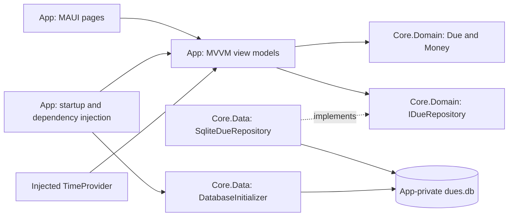

> Historical snapshot preserved during the 2026-10-17 documentation refactor. The body below retains the pre-refactor SDD, including claims superseded by current source inspection; relative links were rebased. Use the [documentation index](../README.md), [PRD](../PRD.md), [current SDD](../SDD.md), and [STATUS](STATUS.md) for current authority. Original section headings remain available for historical references.

# Due Date Checker — Software Design Document

Date: 2026-10-13; implementation status updated 2026-10-17.  
Status: V1.1–V1.3 local CRUD implementations complete. V1.2 functional checks user-accepted; V1.3 basic phone checks verified. Intended-key signing and remaining device cases are pending.  
Source: [PLAN.md](../PLAN.md), especially “v1 re-scope (2026-10-10, approved)”.

## 1. Purpose and scope

Deliver an Android app that stores dues locally, lets the user create, list, edit, mark paid/unpaid, and soft-delete them, and preserves successful changes across app restarts. The target users are students and employees in the Philippines. Amounts use PHP; the product timezone is Asia/Manila regardless of the developer's timezone.

The approved 2026-10-10 re-scope takes precedence over the original seven-day schedule. Reminders, notification permissions, login, Supabase, synchronization, recurring dues, budgets, savings, and Play publishing are outside v1. Notification reliability and the Overdue fallback belong to a later release. v1 requires no internet connection or account.

This document specifies the existing Core contracts and implemented V1.1–V1.3 App integration. The [V1.1](../phases/V1.1.md), [V1.2](../phases/V1.2.md), and [V1.3](../phases/V1.3.md) records list delivered work, verification, and remaining acceptance.

## 2. Plan review (2026-10-13 baseline)

The local CRUD scope fits the production project structure. Money, Due, the repository, and the first migration already implement much of the proposed foundation. These findings describe the review baseline; section 9 records subsequent implementation.

| Priority | Finding and evidence | Design response |
|---|---|---|
| High | The historical S0–S3 schedule and reminder promise remain alongside the approved CRUD re-scope in PLAN.md. | Treat V1.0–V1.3 as the mandatory release scope. Keep all notification and sync decisions deferred. Do not use the expired seven-day dates as a new commitment. |
| High | MauiProgram has no database or repository registration; App creates the template Shell and MainPage. | Initialize the database before exposing CRUD commands and replace the template with the two pages in section 6. |
| High | The plan reports a Release build, but signing with the intended keystore and launcher testing on the phone remain pending. | A successful build alone does not complete V1.0. Validate the intended signing identity and run the phone checks in section 10. |
| Medium | GetAsync returns tombstones, and UpdateAsync can write deleted_at, including clearing it. | The App must reject deleted records when opening or saving an edit. Normal edits preserve DeletedAt; there is no restore flow in v1. |
| Medium | Current tests cover basic round trips, but do not exercise reopening after writes, migration rollback, amount overflow, or deleted-record edit handling. | Add the targeted behavior checks in section 10 during implementation. Existing test results do not establish phone persistence or migration failure recovery. |
| Medium | The schema has no CHECK constraints for nonnegative amounts, paid flags, or fixed currency/timezone. Due validates title, but does not enforce timestamp relationships or identifier validity. | Use the domain factories and App mutation rules. Document this as application-enforced integrity, not database-enforced integrity; any later constraint changes need a new migration. |
| Low | ListActiveAsync sorts by due_date and created_at, while the partial index contains only due_date. | Keep the current query for v1. The index supports the active/date portion; sorting ties may need extra work. Add an id tie-breaker and composite index only if stable ties or measured performance require them. |
| Low | The historical learner notes contain stale “not implemented” statements and resolved decisions listed as open. | Use source files for implementation status and the approved re-scope for product scope. Screen design remains a learner checkpoint before code implementation. |

Policy and dependency claims in the historical plan have not been revalidated by this document. Toolchain/package values below describe checked-in configuration; Play requirements and notification platform behavior must be checked when those slices begin.

## 3. Requirements and traceability

“Active” means not soft-deleted. Paid dues are still active and remain visible.

| ID | Requirement | Slice | Component | Acceptance evidence |
|---|---|---|---|---|
| R01 | A Release APK installs and launches from the phone launcher. | V1.0 | Android App, signing configuration | Intended signing key verified; launcher smoke test passes. |
| R02 | Create a due with required title, amount, and date; notes are optional. | V1.1 | DueEditPage, DueEditViewModel, Due, Money | Two saved dues survive process termination and relaunch. |
| R03 | List all active dues by ascending due date. | V1.1 | DuesListPage, ListActiveAsync | Earlier dates precede later dates; empty state appears with no active dues. |
| R04 | Edit title, amount, date, and notes while keeping the same identity. | V1.2 | DueEditViewModel, UpdateAsync | Saved values survive relaunch; Id and CreatedAt remain unchanged. |
| R05 | Set paid/unpaid status. | V1.2 | DueEditPage, UpdateAsync | Both status transitions persist and remain visible in the list. |
| R06 | Confirm deletion, hide the due, and retain its database row. | V1.3 | DueEditPage, SoftDeleteAsync | Cancel keeps the row active; confirm records DeletedAt and removes it from the list. |
| R07 | All v1 operations work offline. | All mandatory slices | App-private SQLite | CRUD acceptance tests pass in airplane mode. |
| R08 | Optionally run Core tests on push. | V1.4 | Future CI workflow | A push runs the test project successfully; CI is not a mandatory v1 feature. |

Input rules:

- Title is required, must contain a non-whitespace character, and is trimmed by Due.
- Amount is required, nonnegative, and representable as a signed 64-bit centavo count after decimal rounding. Zero is valid. Use decimal, never double, for conversion.
- Amount entry uses an explicit invariant decimal format: digits and an optional decimal point, without currency symbols or grouping separators. Label the field “Amount (PHP)” and show a format hint. Decimal input is rounded using Money.FromDecimal; the peso preview shows the stored value.
- Due date is required and represents a calendar date. Past dates are allowed because existing obligations must be recordable. Date display uses an explicit format such as `dd MMM yyyy` with invariant culture.
- Notes are optional. Normalize empty/whitespace-only notes to null; otherwise preserve their text.
- No title or notes maximum length is imposed by the current domain. A future limit requires a product decision and consistent UI/domain validation.

The amount entry format, past-date allowance, and notes normalization are implemented in V1.1. V1.2 adds the paid switch for existing dues, persisted on Save. V1.3 places a destructive Delete due action after the editor's Save/Cancel actions, visible only for loaded, available existing records.

## 4. Architecture

| Project | Responsibility | Current configuration |
|---|---|---|
| src/DueDateChecker.Core | Domain values, repository abstraction, raw SQL implementation, embedded migrations | net10.0; Microsoft.Data.Sqlite 10.0.12 |
| src/DueDateChecker.App | Android UI, view models, navigation, database path, clock and DI wiring | net10.0-android; CommunityToolkit.Mvvm 8.4.2; MAUI Controls version from MauiVersion |
| tests/DueDateChecker.Core.Tests | Domain and repository behavior using temporary database files | xUnit; Core reference |
| tests/DueDateChecker.App.Tests | Platform-independent view-model and dispatcher behavior, including real SQLite persistence and controlled failures | net10.0; linked App sources, xUnit, CommunityToolkit.Mvvm; no MAUI runtime |

Domain files must not depend on MAUI or SQLite types. Core.Data implements the domain repository interface. App is the composition root and may reference both Core namespaces. This folder boundary is currently a convention inside one assembly.

Keep the existing repository abstraction; v1 does not need a generic repository, server API, sync service, or notification scheduler. View models use CommunityToolkit.Mvvm ObservableObject and generated commands/properties. Page code handles navigation and dialog presentation, while view models handle validation, domain construction, and repository calls.

SQLite calls currently expose Task methods but execute synchronously underneath. Awaiting them alone does not guarantee a responsive UI. DatabaseDispatcher runs database initialization and repository work on a background task and serializes operations using SemaphoreSlim. View models await those operations and apply bound state changes on the UI context. The dispatcher holds no long-lived connection and introduces no SQLite types into Domain.

## 5. Data design

### 5.1 Domain types and mutation rules

Money is a readonly record struct containing `long Centavos`. FromCentavos rejects negatives. FromDecimal multiplies by 100, rounds with MidpointRounding.AwayFromZero, and converts to long. Overflow must become a user validation error, including overflow during multiplication. ToString uses a fixed peso symbol and invariant `N2` formatting; for example, 245000 centavos displays as `₱2,450.00`.

Due is an immutable record containing Id, Title, Amount, DueDate, Notes, IsPaid, CreatedAt, UpdatedAt, and DeletedAt. Title validation also applies to a `with` edit. The App uses these mutation rules:

| Operation | State transition |
|---|---|
| Create | Due.Create generates a Guid, sets IsPaid=false and DeletedAt=null, and sets CreatedAt=UpdatedAt=now. |
| Edit or paid toggle | Copy the loaded active record with changed editable fields and UpdatedAt=now; preserve Id, CreatedAt, and DeletedAt. |
| Delete | SoftDeleteAsync sets DeletedAt=UpdatedAt=now, preserving other fields and the physical row. |

Obtain `now` from injected TimeProvider.GetUtcNow(). Store new App writes as UTC timestamps. The current mapper also accepts historical round-trip timestamps with nonzero offsets. Timestamp ordering is not a conflict-resolution algorithm; device clock changes can move UpdatedAt backwards. Future sync requires its own explicit policy.

DueDate remains DateOnly and must never be converted to UTC for persistence. The default date in a new form is today's date in Asia/Manila derived from the injected clock. The timezone provider belongs in App; Core receives the resulting DateOnly.

### 5.2 SQLite schema

The existing authoritative script is [001_create_dues.sql](../../src/DueDateChecker.Core/Data/Migrations/001_create_dues.sql). Its user_version is 1.

| Column | SQLite type | Meaning |
|---|---|---|
| id | TEXT PRIMARY KEY | Guid formatted as standard text; assigned before insert. |
| title | TEXT NOT NULL | Trimmed, required domain title. |
| amount_centavos | INTEGER NOT NULL | Nonnegative signed 64-bit centavo value. |
| currency | TEXT NOT NULL DEFAULT 'PHP' | Fixed v1 currency; reserved for future evolution. |
| due_date | TEXT NOT NULL | Invariant `yyyy-MM-dd`; lexicographic order matches calendar order. |
| notes | TEXT nullable | Optional user text. |
| is_paid | INTEGER NOT NULL DEFAULT 0 | App writes 0 or 1. |
| timezone | TEXT NOT NULL DEFAULT 'Asia/Manila' | Fixed product timezone; reserved for later reminders/sync. |
| created_at | TEXT NOT NULL | DateTimeOffset round-trip `O` format. |
| updated_at | TEXT NOT NULL | Last mutation timestamp in the same format. |
| deleted_at | TEXT nullable | Null means active; a value is a tombstone. |

Currency and timezone are not properties on the current Due record and are not mapped by SqliteDueRepository. Inserts obtain their SQL defaults; updates leave them untouched. They prepare storage for future work but do not implement multi-currency support or sync.

The partial index `ix_dues_active_due_date` indexes due_date where deleted_at is null. The current list order is due_date, then created_at. Equal values for both keys have no guaranteed relative order. Paid status is not a list filter.

### 5.3 Repository contracts

| Method | Behavior |
|---|---|
| ListActiveAsync() | Return all rows with DeletedAt=null, including paid rows, sorted by due_date and created_at. |
| GetAsync(Guid id) | Return a row including tombstones, or null for an unknown id. |
| AddAsync(Due due) | Insert the supplied record. Duplicate ids fail through SQLite. |
| UpdateAsync(Due due) | Update editable fields and UpdatedAt on active rows; preserve stored CreatedAt/DeletedAt. Throw KeyNotFoundException for an unknown or soft-deleted id. |
| SoftDeleteAsync(Guid id, DateTimeOffset when) | Set both deletion/update timestamps only on an active row. Unknown/already deleted ids are a no-op. |

All user values use SQL parameters. Each operation opens and disposes a connection; no connection is shared between view models. Each mutation is one atomic SQL statement. There are no cancellation-token parameters in the current interface; UI lifecycle cancellation must not be presented as cancellation of an already-running write.

Before saving an existing due, load it again and reject null or DeletedAt!=null. The read/check/update share one dispatcher operation. UpdateAsync additionally enforces `WHERE id = @id AND deleted_at IS NULL` and never writes deleted_at, preventing a stale edit from restoring a tombstone even when deletion occurs after the read. Multi-writer edit conflicts remain outside v1; a future sync design needs an explicit concurrency policy.

### 5.4 Initialization and migrations

App owns `Path.Combine(FileSystem.AppDataDirectory, "dues.db")` and supplies exactly the same path to DatabaseInitializer and SqliteDueRepository. Core never discovers platform directories.

Initialize once per process before any repository access. DatabaseInitializer opens/creates the file, reads PRAGMA user_version, loads embedded numbered SQL scripts, and applies each newer script in numeric order. Each script and its version bump share one transaction. Re-running initialization at version 1 is a no-op.

Add future changes as `002_*.sql`, `003_*.sql`, and so on; do not edit an already shipped migration. Migration failure blocks normal UI access and offers retry without deleting the database. The initializer now rejects negative/newer-than-supported user_version values without resetting the file; the newer-schema behavior is covered by a preservation test.

## 6. UI and navigation

The App contains Pages/DuesListPage and Pages/DueEditPage, with corresponding view models in ViewModels/. AppShell hosts the injected list root and registers the form route; App receives AppShell through constructor injection. The template MainPage is removed. Add opens a fresh form; selecting a row opens the same page in edit mode.

V1.2 navigates using only a due id and loads its data through the repository. No id means create mode; a supplied invalid id is unavailable and cannot become an insert. DueEditPage uses IQueryAttributable and observes its load command on appearance. Once loaded, repeated query/appearance events do not overwrite unsaved input. V1.3 completes the delete actions in the following table.

| Screen | Bound state | Commands and behavior |
|---|---|---|
| DuesListPage | Active dues collection, IsBusy, error message, empty state | Load/refresh and Add; selecting a row opens edit mode. Each row shows title, formatted amount/date, and paid/unpaid text. |
| DueEditPage | Title, AmountText, selected date, Notes, IsPaid, create/edit mode, validation errors, IsBusy | Load, Save, Cancel; edit mode also offers Delete with confirmation. Paid state is editable and persists on Save. |

Use a CollectionView for the list. Paid state must have a text indication; color alone is insufficient. Give fields and actions accessible labels. Save and delete controls are disabled during an operation, and refresh is prevented from overlapping another load. New dues default to unpaid; the paid control is introduced for existing dues in V1.2.

Reload the list when it appears after returning from the editor and when the app resumes. Do not append optimistic rows and then load them again. A successful repository write precedes navigation and visible success. If saving succeeds but navigation fails, retain the saved identity/state so retrying navigation cannot insert a duplicate.

Save flow:

1. Validate title, amount parsing/range, and date selection; show field errors without touching the database.
2. Convert amount through Money.FromDecimal; show the resulting peso value.
3. Capture one clock instant. In create mode, construct Due.Create; in edit mode, re-read the active record and copy editable fields.
4. Await AddAsync or UpdateAsync through the serialized background dispatcher.
5. On success, return to the list and reload it. On failure, keep form contents and present a retryable error.

Delete flow:

1. DueEditPage shows a native confirmation naming the original stored title. A page action guard prevents overlapping dialogs/actions. Cancel/back dismissal supplies false to the command and performs no storage call.
2. On explicit confirmation, DeleteCommand checks that the target is an existing, loaded, available, incomplete record. It passes the id and one clock instant to SoftDeleteAsync through the dispatcher; it does not validate or save unfinished form values.
3. After successful completion, mark HasDeleted, return to the list, and reload. On failure, retain the page/input and allow a newly confirmed retry. Save/Delete are disabled during writes. After a navigation failure, HasCompleted provides Back to dues without repeating a mutation.

The destructive button uses semantic overdue/surface colors, outline, and minimum dimensions from DESIGN.md. The approved v1 scope has no Undo/restore interaction; the broader product design's Undo remains deferred.

Back/Cancel discards unsaved fields without writing. A deleted or unknown navigation target displays “This due is no longer available” with a return-to-list action. v1 has no recycle bin or restore command.

## 7. Dependency lifetimes and startup

| Registration | Lifetime | Reason |
|---|---|---|
| DatabaseInitializer | Singleton | One file path and an awaited startup initialization. |
| IDueRepository → SqliteDueRepository | Singleton | Holds only the path; connections are per operation. |
| TimeProvider.System | Singleton | One injectable clock source; tests substitute a fixed clock. |
| Database operation dispatcher | Singleton | Serializes initialization/reads/writes off the UI thread. |
| AppShell | Per app window | Root navigation container. |
| Pages and view models | Transient | Separate form state per navigation. |

The bootstrap sequence is: build DI registrations, display the list's startup/loading state, initialize SQLite in the dispatcher, then enable Add. The load task is awaited; startup errors remain visible and retry must complete initialization before Add becomes available. There is one Android window and no background writers in v1.

V1.1 implements this through an awaited list-load command: the list page initially displays loading state and disables Add until initialization completes. The page shares its load task across appearance/resume events. Lifecycle event handlers await the task; the view model catches initialization/read failures, displays a retry message, and keeps CRUD unavailable on startup failure.

## 8. Failure handling, privacy, and practical limits

| Failure | Required behavior |
|---|---|
| Invalid/overflowing amount or blank title | Show a field error; preserve input; do not write. |
| Database initialization/migration failure | Block CRUD, show a startup error with retry, and preserve the file. |
| Database locked, storage full, or other write failure | Keep the form/row state, end the busy state, and allow retry; do not report success. |
| List refresh failure | Retain previously loaded data with a visible error; do not imply that the list is freshly loaded. |
| Unknown/deleted edit target | Prevent saving; offer return to list. |
| Process termination before write completion | On relaunch, reload committed database state; an unsaved form is not guaranteed to survive. |
| Damaged database or unsupported future schema | Preserve data and block unsafe access; do not silently recreate or downgrade the file. The future-version guard is implemented. |

SQLite is the source of truth. There is no export, account restore, or server backup in v1. App-private storage and `android:allowBackup="false"` are configured, but this is ordinary SQLite without application-level encryption. Uninstalling or clearing app data loses dues; soft deletion preserves a row only while the database remains present.

Do not log titles, amounts, notes, raw SQL parameters, or signing passwords. Keep keystores outside the repository and local.signing.props ignored. The existing Android manifest retains template INTERNET and ACCESS_NETWORK_STATE permissions; no v1 functionality should make network calls. Removing unused permissions can be considered during release cleanup.

## 9. Delivery slices and implementation status

| Slice | Observed foundation | Remaining work |
|---|---|---|
| V1.0 | Android project, Core reference, signing props import, allowBackup=false | Intended keystore configuration, signed Release APK installation, and launcher acceptance on a real phone. |
| V1.1 | Money, Due, repository, initializer, embedded schema, DI/path/startup wiring, list/create pages and view models, automated Core/App tests | Signed Release real-phone create/list/restart and airplane-mode acceptance. |
| V1.2 | Row navigation, editor loading/retry, edit/paid controls, timestamp rules, App and SQL active-row guards, automated tests; functional phone checks user-accepted | Intended-key signed acceptance and remaining unchecked phone hardening items in the phase record. |
| V1.3 | Confirmation UI, no-write Cancel, tombstone/list refresh, failure/retry, repeated-delete tests, native Cancel/Delete/restart checks | Native offline/Back/theme/large-text/repeated-tap checks and intended-key signing. |
| V1.4 optional | Test project exists | Core-only workflow on push; APK build may be a later manual workflow. |

As of 2026-10-17, V1.1–V1.3 implement local CRUD with confirmed soft deletion. Current automated results are 28 passing Core cases and 42 passing App cases (70 total). The new slice adds confirmation-result guards, no-write cancellation, retained-field/tombstone persistence, failure/retry, duplicate-action blocking, and repeated deletion preserving the first timestamps.

The V1.2 Android Release build passed with zero warnings/errors and produced `src/DueDateChecker.App/bin/Release/net10.0-android/com.lem.duedatechecker-Signed.apk`. Agent phone checks verified install/start, navigation, populated fields, switch interaction, Cancel, and repeat selection without saving changes. The user subsequently accepted V1.2 saved-edit/paid/restart and airplane-mode checks; this confirmation is separate from agent-observed evidence. Intended-key signing and unchecked phone hardening items remain tracked; local.signing.props was absent at the last inspection. NuGet vulnerability metadata retained the earlier restore warning; tests used cached dependencies successfully. No new tests were run for the acceptance update.

V1.3 verification on 2026-10-17: the Release build passed with zero warnings/errors and the updated APK installed. Native phone checks used only agent-created zero-amount dues: Cancel retained the editor/record; confirmed Delete returned to the list and hid the due; after force-stop/relaunch it stayed hidden. Existing user dues were not edited/deleted. Private database retention was established in automated repository tests rather than by extracting the phone database. Intended-key signing and the unchecked cases in the V1.3 record remain outstanding.

## 10. Verification and acceptance

During implementation, run `dotnet test tests/DueDateChecker.Core.Tests/DueDateChecker.Core.Tests.csproj` so Core validation does not depend on restoring the MAUI App. Build/publish the Android App in Release separately. A documentation-only change does not require an Android build.

For view-model integration checks, also run `dotnet test tests/DueDateChecker.App.Tests/DueDateChecker.App.Tests.csproj`. This harness links the actual platform-independent App services/view models, so it does not validate XAML, Android handlers, navigation, or Release trimming. Those require the Android build and phone acceptance below.

Completed V1.1 coverage includes amount validation/overflow and the maximum accepted centavo boundary; reopened-file create/list persistence and sorting; PHP/Asia/Manila defaults; required title/date; Manila's date boundary; save failure/retry; duplicate-save protection; startup failure/retry; refresh failure retaining rows; and unsupported-schema rejection preserving data.

Completed V1.2 coverage includes reopened-file edit/paid persistence, preserved Id/CreatedAt, UpdatedAt from the clock, list ordering and paid text after reload, invalid edits, missing/deleted edit targets, repeated loads preserving input, read/write retries, repeated Save, and deletion before or during Save. Repository tests cover unknown/deleted update rejection and preservation of CreatedAt/DeletedAt.

Completed V1.3 coverage includes reopened-file tombstone persistence with original fields retained, no-write cancellation, hidden/disabled delete states, failure/retry, concurrent Save/Delete guards, completed-operation navigation retry, preservation of an existing tombstone, repeated deletion timestamps, and unknown-id isolation.

Remaining targeted coverage for later behavior/hardening:

- Due-date ties follow the documented created_at order; paid rows remain listed.
- A failing migration rolls back its schema changes and version bump; initialization preserves existing rows. Introduce a controlled migration test seam when implementing that check.
- Native offline/Back/theme/large-text/repeated-tap behavior from the phase checklists. Keep MAUI dependencies out of Core.Tests; use the existing App test harness for later platform-independent behavior.

Use isolated temporary file databases and close/clear pooled connections before cleanup, as the current tests do. Test failure cases rather than generated MVVM boilerplate.

Mandatory real-phone acceptance, using the intended signed Release APK:

| Check | Procedure | Pass condition |
|---|---|---|
| Install/start | Install APK, then launch from the launcher. | App opens; merged manifest confirms allowBackup=false and the intended supported Android configuration. |
| Create/list/restart | Add two dues in reverse date order, terminate the process, relaunch. | Both appear with correct fields in ascending date order. |
| Edit/paid/restart | Change each editable field; mark paid, restart, then mark unpaid and restart. | All changes persist; identity is retained; paid/unpaid rows remain visible. |
| Delete/cancel/restart | Cancel deletion once, then confirm it, terminate and relaunch. | Cancel changes nothing; confirmed row stays hidden; repository inspection shows a tombstone. |
| Offline | Repeat create/edit/paid/delete in airplane mode. | All operations work and persist. |
| Failure/retry | Exercise invalid input, repeated taps, and a controlled storage failure in a test build. | No duplicate inserts, false success, or lost form input. |

V1.2's saved-edit/paid/restart and offline checks are user-accepted. V1.3 native Cancel/Delete/restart visibility checks are agent-verified with temporary dues. The intended-key signed pass, V1.1's separate checklist, and unchecked phone cases are still tracked in phase records. There are no notification, Doze, boot-receiver, or deep-link acceptance gates for v1.

## 11. Deferred decisions and extension points

- Notifications: choose scheduler implementation, exactness policy, reminder fan-out, reconciliation triggers, permission handling, and tap navigation in a later slice. Calendar dates plus the stored product timezone are inputs, not an implemented scheduler.
- Sync/auth: preserve Guid identities and tombstones, but design outbox, server ownership, conflict handling, RLS, and token storage separately. Existing timestamp columns alone do not make sync reliable.
- Encryption and backup/export: no SQLCipher decision is recorded. Review the data-loss/privacy tradeoff before expanding the persistence model.
- Distribution: the v1 deliverable is a sideloaded APK. Resolve Play App Signing and current store requirements before a Play release.
- Learner workflow: create/list implementation was authorized on 2026-10-16. Retain learning/review checkpoints for the next slice; authorization alone does not establish demonstrated understanding.

Mandatory local CRUD feature implementation is complete. Remaining work is signing/release acceptance and unchecked phone cases; V1.4 CI is optional. Notification/server decisions remain deferred.

## 12. Implementation references

- [MAUI dependency injection](https://learn.microsoft.com/en-us/dotnet/maui/fundamentals/dependency-injection?view=net-maui-10.0): constructor injection and transient pages/view models.
- [MAUI DatePicker](https://learn.microsoft.com/en-us/dotnet/maui/user-interface/controls/datepicker?view=net-maui-10.0): nullable date binding in .NET 10.
- [MVVM Toolkit commands](https://learn.microsoft.com/en-us/dotnet/communitytoolkit/mvvm/generators/relaycommand): generated async commands and CanExecute notifications.
- [MAUI Shell navigation](https://learn.microsoft.com/en-us/dotnet/maui/fundamentals/shell/navigation?view=net-maui-10.0): id query handling through IQueryAttributable.
- [CollectionView selection](https://learn.microsoft.com/en-us/dotnet/maui/user-interface/controls/collectionview/selection?view=net-maui-10.0): selection events and clearing SelectedItem for repeated navigation.
- [MAUI DisplayAlertAsync](https://learn.microsoft.com/en-us/dotnet/api/microsoft.maui.controls.page.displayalertasync?view=net-maui-10.0): native confirmation returning an explicit Boolean choice.
