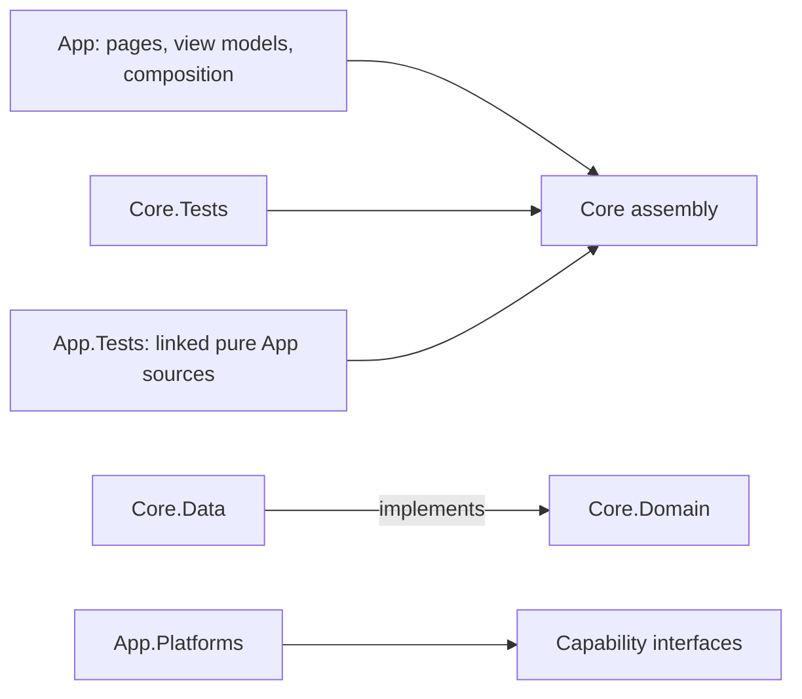

# Proposed project structure

**Future-project proposal.** Read the [kit guide](README.md) before copying. `{{ProjectName}}` is a placeholder; the tree describes files to create as needed, not a prebuilt solution. The [copyable documentation](project/docs/README.md) contains the working templates.

## Small application baseline

```text
{{ProjectName}}/
  README.md
  AGENTS.md
  {{ProjectName}}.slnx
  global.json
  .editorconfig
  .gitignore
  .github/workflows/ci.yml       # if GitHub is the selected CI service
  src/
    {{ProjectName}}.Core/
      Domain/                  # values, policies, repository/capability contracts
      Data/                    # chosen persistence implementation, if needed
        Migrations/            # ordered embedded SQL, if using that approach
      {{ProjectName}}.Core.csproj
    {{ProjectName}}.App/
      App.xaml + App.xaml.cs
      AppShell.xaml + AppShell.xaml.cs
      MauiProgram.cs           # composition root
      Pages/                   # XAML, UI event adapters, dialogs/navigation
      ViewModels/              # presentation state, validation, commands
      Services/                # app orchestration, dispatch, navigation adapters
      Platforms/               # only selected targets and native implementations
      Resources/
        AppIcon/ Splash/ Images/ Fonts/ Raw/ Styles/
        Localization/          # .resx strings when adding localization
      {{ProjectName}}.App.csproj
  tests/
    {{ProjectName}}.Core.Tests/ # domain and persistence tests, no MAUI runtime
    {{ProjectName}}.App.Tests/  # platform-independent presentation/service tests
  docs/
    README.md PRD.md SDD.md DESIGN.md
    SETUP.md DEVELOPMENT.md RELEASE.md REFERENCES.md
    adr/README.md + TEMPLATE.md
    delivery/STATUS.md + TEST-PLAN.md
    delivery/evidence/TEMPLATE.md
  specs/
    feature-template/spec.md + plan.md + tasks.md
  tools/
    README.md
    check_docs.py              # included read-only documentation checker
    tests/test_check_docs.py   # included checker behavior tests
    verification/              # add reproducible device/link-check helpers here
  artifacts/                   # ignored local logs, builds, controlled fixtures
```

Keep assets used at runtime under App/Resources so packaging is explicit. Keep editable design originals and their licenses under `docs/assets/` only when needed; runtime and design originals have different owners. Preserve font/image license notices with the assets. Do not copy Duewise branding into unrelated products.

## Dependency boundaries



`App -> Core` is the production project reference. Core must never reference App or MAUI. Within Core, Domain must not reference Data or provider-specific types; Data implements Domain contracts. This is a folder convention inside one assembly, so reviews enforce it. Having SQLite in Core does not make the entire assembly dependency-free.

Pages own controls, native dialogs, and navigation execution. View models own screen state and call domain/application contracts. Domain owns invariants independently of the UI. App startup selects implementations, database paths, and clocks. A platform adapter implements a capability interface and returns explicit unsupported/unavailable states where necessary. Shared startup must not reference an Android-only concrete type without a target-specific registration boundary.

For the two-project baseline, App.Tests may link only MAUI-independent ViewModels/Services sources, as Duewise does. List those files deliberately and align compiler options, source-generator packages, and symbols with App. These tests compile their own copy of those sources: they do not exercise the App assembly, XAML, DI graph, or native runtime. A real App build remains required. Avoid blanket inclusion of every App service as native adapters are added.

## Folder responsibilities

| Location | What belongs here | Avoid |
|---|---|---|
| Domain | Models, immutable values, business rules, typed statuses/IDs | Display-label comparisons, controls, SQL connections |
| Data | Queries, mapping, connection policy, migrations | Page state and user-facing dialogs |
| ViewModels | Observable state, async commands, screen validation | Shell globals, platform types, raw SQL |
| Pages | Binding, visual behavior, lifecycle adapters | Duplicated domain rules |
| Services | App workflows and interfaces for external capabilities | An unstructured collection of all helper methods |
| Platforms | Manifests, entitlements, OS integrations, handlers | Product rules that should behave consistently across targets |
| Tests | Observable outcomes, controlled clocks/failures, isolated storage | Assertions that only repeat implementation steps |
| Docs/specs | Current authorities, feature plans, attributed evidence | Multiple copies of product rules or assumed test passes |
| Tools | Repeatable build/verification helpers | Developer-specific absolute paths or production credentials |

## Grow only when the boundary pays for itself

| Trigger | Optional change | Cost/tradeoff |
|---|---|---|
| Source-linked tests drift or presentation logic is substantial | Extract `{{ProjectName}}.Presentation` targeting plain .NET; App and Presentation.Tests reference it | One extra production assembly; keep MAUI APIs in App adapters |
| Multiple storage providers, a server host, or enforceable domain isolation | Extract `{{ProjectName}}.Infrastructure`; App composes it and Core; Infrastructure references Core | More project/dependency management, with enforceable isolation |
| Use cases shared by UI, background work, or multiple frontends | Add an Application layer for those workflows | Useful sharing; unnecessary indirection for trivial CRUD |
| Many related screens become hard to navigate | Group App code under `Features/<Feature>/` | Improves cohesion; choose one convention instead of duplicating folders |
| Repeated native regressions | Add selected UI automation and platform integration projects | Device runners and fixture maintenance have real costs |

Adding a second platform alone does not require these layers. It requires working adapters, appropriate hosts, platform builds, and native acceptance. Generic repositories, service interfaces for every class, CQRS, event buses, cloud sync, and a dedicated UI automation farm are optional decisions with their own evidence and rationale.
